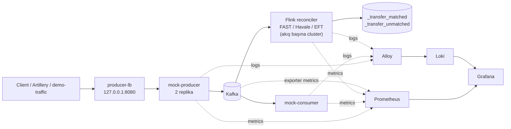

# Transfer Events Lab (FAST, Havale, EFT)

Bu proje FAST, Havale ve EFT transfer event'lerinin Kafka üzerinden taşınmasını, Apache Flink ile eşleştirilmesini (reconciliation) ve Grafana'da ekiplere göre gözlemlenmesini gösteren yerel bir laboratuvar ortamıdır.

Projeyi yeni açan bir geliştirici için en önemli fikir şudur:

> Producer bir transferin **request** event'ini yayınlar; daha sonra aynı `transaction_id` için **success** veya **failed** sonucu gelir. Her akışın (FAST, Havale, EFT) kendi Flink reconciler'ı bu iki event'i eşleştirir, sonucu `<akış>_transfer_matched` / `_unmatched` topic'lerine yazar ve iş metrikleri üretir.

## İçindekiler

- [Mimariyi hızlıca anlama](#mimariyi-hızlıca-anlama)
- [Servisler](#servisler)
- [Event akışı](#event-akışı)
- [Projeyi çalıştırma](#projeyi-çalıştırma)
- [Test transferi gönderme](#test-transferi-gönderme)
- [Reconciler’lar](#reconcilerlar)
- [Grafana ve gözlemlenebilirlik](#grafana-ve-gözlemlenebilirlik)
- [Prometheus metrikleri](#prometheus-metrikleri)
- [Kalıcı volume klasörleri](#kalıcı-volume-klasörleri)
- [Proje yapısı](#proje-yapısı)
- [Performans testleri](#performans-testleri)
- [Geliştirme ve test](#geliştirme-ve-test)
- [Sorun giderme](#sorun-giderme)

## Mimariyi hızlıca anlama



Eşleştirmeyi Flink yapar: her akışın (FAST, Havale, EFT) kendi Flink cluster'ı vardır ve hepsi aynı kodu çalıştırır.

## Servisler

| Servis | Teknoloji | Görevi | Adres / port |
|---|---|---|---|
| `kafka` | Apache Kafka 4.4 | Event ve output topic’lerini taşır | `localhost:9092` |
| `kafka-init` | Kafka CLI | Gerekli topic’leri oluşturur | Tek seferlik servis |
| `mock-producer` | .NET 10 | HTTP event API’si ve Kafka producer | İç port `8080` |
| `producer-lb` | nginx | Producer replica’ları için tek giriş noktası | `http://127.0.0.1:8080` |
| `mock-consumer` | .NET 10 | Her akışın topic'lerini kendi consumer group'uyla okur; `/healthz` | İç port `2114` |
| `flink-checkpoint-init` | Flink image | Flink image’ını build eder, akış başına checkpoint klasörlerini hazırlar | Tek seferlik servis |
| `flink-jobmanager` | Apache Flink 2.1.3 | Paylaşılan session cluster’ı; UI ve job yönetimi | `http://localhost:18081` |
| `flink-taskmanager` (3 replika) | Apache Flink 2.1.3 | Job task’lerini çalıştırır (5 slot) | Metrics portu `9249` |
| `flink-job-supervisor` | Flink image | FAST, Havale ve EFT job’larını çalışır tutar; checkpoint’ten yeniden başlatır | Sürekli çalışır |
| `kafka-exporter` | kafka-exporter | Consumer group lag ve offset metrikleri | `9308` |
| `kafka-jmx-exporter` | prometheus/jmx_exporter 1.7.0 (resmi jar, checksum ile sabit) | Kafka broker metrikleri | `5556` |
| `prometheus` | Prometheus | Metrikleri scrape eder ve saklar | `http://localhost:9090` |
| `loki` | Loki | Logları saklar | `http://localhost:3100` |
| `alloy` | Grafana Alloy | Docker loglarını Loki’ye gönderir | Internal |
| `grafana` | Grafana | Dashboard ve alert ekranı | `http://localhost:3000` |

`mock-producer` iki replika, `mock-consumer` tek replika çalışır. Flink tarafında her akışın (FAST, Havale, EFT) kendi cluster’ı vardır: bir JobManager ve bir TaskManager. Üç cluster da aynı image’ı ([flink/reconciler/](./flink/reconciler/)) kullanır; hangi akışın çalışacağını `FLOW` ortam değişkeni belirler. State, checkpoint, consumer group, Kafka transaction id’leri ve metrik endpoint’i her akış için ayrıdır.

## Event akışı

### Input topic’leri

Her event'in bir HTTP endpoint'i ve aynı adlı bir Kafka topic'i vardır. Kafka message key'i `transaction_id`'dir.

| Akış | Request | Success | Failed |
|---|---|---|---|
| FAST gelen | `/events/fast/incoming/request` → `fast_incoming_request` | `…/success` → `fast_incoming_success` | `…/failed` → `fast_incoming_failed` |
| FAST giden | `/events/fast/outgoing/request` → `fast_outgoing_request` | `…/success` → `fast_outgoing_success` | `…/failed` → `fast_outgoing_failed` |
| Havale | `/events/havale/request` → `havale_request` | `…/success` → `havale_success` | `…/failed` → `havale_failed` |
| EFT gelen | `/events/eft/incoming/request` → `eft_incoming_request` | `…/success` → `eft_incoming_success` | `…/failed` → `eft_incoming_failed` |
| EFT giden | `/events/eft/outgoing/request` → `eft_outgoing_request` | `…/success` → `eft_outgoing_success` | `…/failed` → `eft_outgoing_failed` |

Mock consumer her akışın topic'lerini kendi consumer group'uyla (`fast_incoming`, `fast_outgoing`, `havale`, `eft_incoming`, `eft_outgoing`) okur ve teknik metrik üretir.

### Output topic’leri

| Topic | İçerik |
|---|---|
| `fast_transfer_matched`, `havale_transfer_matched`, `eft_transfer_matched` | Request'i ile sonucu eşleşen transferler (tutar, bankalar, sonuç, tamamlanma süresi) |
| `fast_transfer_unmatched`, `havale_transfer_unmatched`, `eft_transfer_unmatched` | 10 dakikalık TTL sonunda eşleşemeyen request'ler veya sonuçlar |

## Projeyi çalıştırma

Gereksinimler:

- Docker Desktop
- Docker Compose v2
- Performans testleri için Node.js ve npm
- Docker dışında Java testleri için JDK 21 ve Maven

Tüm stack’i başlatmak için:

```powershell
docker compose up -d --build
```

Durumu kontrol etmek için:

```powershell
docker compose ps
docker compose logs -f flink-jobmanager
docker compose logs -f mock-consumer
```

Flink job listesini görmek için:

```powershell
Invoke-RestMethod http://localhost:18081/jobs/overview
```

Flink UI (üç job tek yerde): [http://localhost:18081](http://localhost:18081)

Grafana varsayılan giriş bilgileri:

- Kullanıcı: `admin`
- Şifre: `admin`

Grafana anonim erişime de açıktır; dashboard’ları [http://localhost:3000](http://localhost:3000) üzerinden açabilirsiniz.

## Test transferi gönderme

Bir transfer iki event'ten oluşur: request ve aynı `transaction_id` ile sonuç. Örneğin FAST gelen bir transfer:

```powershell
$body = '{"transaction_id":"tx-1001","amount":1250.75,"currency":"TRY","sender_bank":"00010","receiver_bank":"00046"}'
Invoke-RestMethod -Method Post -Uri http://127.0.0.1:8080/events/fast/incoming/request -ContentType 'application/json' -Body $body
Invoke-RestMethod -Method Post -Uri http://127.0.0.1:8080/events/fast/incoming/success -ContentType 'application/json' -Body $body
```

Başarısız sonuçta `failure_reason` zorunludur:

```powershell
Invoke-RestMethod -Method Post `
  -Uri http://127.0.0.1:8080/events/havale/failed `
  -ContentType 'application/json' `
  -Body '{"transaction_id":"tx-1002","amount":500,"failure_reason":"INSUFFICIENT_BALANCE"}'
```

`transaction_id` ve `amount` (> 0) her event'te zorunludur; eşleşen kayıtta tutar ve bankalar request'ten alınır. Başarılı HTTP kabulü `202` (gövdede UUIDv7 event `id`), geçersiz body `400`, bilinmeyen endpoint `404`, Kafka istemci kuyruğuna yazılamazsa `503` döndürür.

Panoları sürekli trafikle doldurmak için: `python performance/demo-traffic/traffic.py` (bkz. [dashboard.md → Demo akışı](./dashboard.md#5-demo-akışı)).

## Reconciler’lar

### Flink reconciler

Kaynak: [flink/reconciler/](./flink/reconciler/)

Tek kod tabanı, akış başına ayrı job ve ayrı cluster. Job’un entry point’i [FlinkReconcilerJob.java](./flink/reconciler/src/main/java/fast/reconciler/flink/FlinkReconcilerJob.java), akış varsayılanları [Flow.java](./flink/reconciler/src/main/java/fast/reconciler/flink/Flow.java) dosyasındadır. Job şu adımları izler:

1. Akışın request, success ve failed topic’lerini Kafka source ile okur.
2. `transaction_id` ile keyBy yapar.
3. `FlinkReconciliationFunction` içinde event’leri eşleştirir.
4. `<flow>_transfer_matched` veya `<flow>_transfer_unmatched` topic’ine exactly-once sink ile yazar.
5. 10 saniyelik checkpoint ile state’i `volumes/flink-checkpoints/<flow>` klasörüne kaydeder.

| Akış (`FLOW`) | Input topic’leri | Output topic’leri | Consumer group / job adı | UI |
|---|---|---|---|---|
| `fast` | `fast_{incoming,outgoing}_{request,success,failed}` | `fast_transfer_matched`, `fast_transfer_unmatched` | `flink-fast-reconciler` |
| `havale` | `havale_{request,success,failed}` | `havale_transfer_matched`, `havale_transfer_unmatched` | `flink-havale-reconciler` |
| `eft` | `eft_{incoming,outgoing}_{request,success,failed}` | `eft_transfer_matched`, `eft_transfer_unmatched` | `flink-eft-reconciler` |

Job ayarları, job’u gönderen `flink-job-supervisor` servisinde verilir; `FLOW` her job için supervisor tarafından ayarlanır:

| Environment variable | Varsayılan | Açıklama |
|---|---:|---|
| `FLOW` | `fast` | `fast`, `havale` veya `eft`; aşağıdaki varsayılanları seçer |
| `KAFKA_BROKERS` | `kafka:9092` | Kafka adresi |
| `APPLICATION_ID` | `flink-<flow>-reconciler` | Job adı, consumer group ve transactional id öneki |
| `SEND_TOPIC`, `SUCCESS_TOPIC`, `FAILED_TOPIC` | akışa göre | Virgülle ayrılmış input topic’leri |
| `MATCHED_TOPIC`, `UNMATCHED_TOPIC` | `<flow>_transfer_matched` / `_unmatched` | Output topic’leri |
| `PENDING_THRESHOLD` | `30s` | Stuck eşiği |
| `MATCH_TTL` | `10m` | Unmatched TTL; eşleşen kayıtların tekrar kontrolü de bu süre kadar tutulur |
| `CHECKPOINT_INTERVAL` | `10s` | Checkpoint aralığı |
| `PARALLELISM` | `3` | Flink job parallelism’i |

Süreler `500ms`, `30s`, `10m`, `1h` biçiminde verilir; geçersiz bir değerde job açık bir hata mesajıyla başlamaz.

**Restart ve state:** [supervise-jobs.sh](./flink/reconciler/docker/supervise-jobs.sh) her 30 saniyede job’ların çalışıp çalışmadığına bakar; çalışmıyorsa akışın en son tamamlanmış checkpoint’inden yeniden gönderir (`volumes/flink-checkpoints/<flow>/<job-id>/chk-N`). JobManager restart’ından sonra bekleyen transferler kaybolmaz. Arayüzden iptal edilen job kendiliğinden geri gelmez; `docker compose exec flink-job-supervisor /opt/flink/docker/supervise-jobs.sh start <flow>` ile başlatılır.

Flink job’unu kontrol etmek için:

```powershell
Invoke-RestMethod http://localhost:18081/jobs/overview
```

Beklenen job adları `flink-<flow>-reconciler`; üçü de `RUNNING` olmalıdır.

## Grafana ve gözlemlenebilirlik

Grafana dashboard’ları dosyadan provision edilir. Elle dashboard oluşturmak yerine JSON dosyasını (ekip panolarında generator script’ini) güncellemek gerekir.

### Ekip panoları (FAST, Havale, EFT)

Her akışın kendi Grafana klasörü ve her klasörde üç ekibe göre hazırlanmış pano vardır. Panoların üstündeki bağlantılarla aynı akışın diğer panolarına veya tüm akışların panolarına geçilebilir.

| Pano | Kimin için | Ne gösterir |
|---|---|---|
| `<Akış> · İş Birimi` | İş birimi, ürün sahipleri | Tamamlanan transfer, başarı oranı, başarılı TRY hacmi, ortalama tutar, tamamlanma süresi, sonuçsuz kalan istekler; dakikalık trend (geçen haftayla karşılaştırmalı); gelen/giden kırılımı (FAST, EFT); banka özeti ve en yüksek hata oranlı bankalar (gönderen / alıcı seçilebilir); başarısızlık nedenleri; akışın iş uyarıları |
| `<Akış> · Geliştirici` | Geliştirme ekibi | API istek hızı, gecikme ve hata kodları; topic bazında Kafka yazma hızı ve reconciler lag’i; mock consumer gecikmesi; reconciler iç durumu (eşleşen / unmatched, pending / stuck / orphan, duplicate ve geçersiz event, tamamlanma süresi histogramı); Flink task throughput ve sink hataları; Flink ve API hata logları (Loki) |
| `<Akış> · SRE` | SRE / operasyon | JobManager, TaskManager, çalışan job, uptime, restart, boş slot, lag, checkpoint yaşı; SLO’lar (sonuca ulaşan istek ≥ %99,9, 5 s içinde tamamlanma ≥ %99, API başarı ≥ %99,9) ve bilgi amaçlı iş kaynaklı başarısızlık oranı; throughput, backpressure, lag, p99; checkpoint süresi / boyutu / hataları; CPU, heap, GC; akışın tüm uyarıları ve hata log sayısı |

Bu 9 pano ve Platform · Servisler / Flink panoları [generate_team_dashboards.py](./observability/grafana/generate_team_dashboards.py) ile üretilir. Panoyu değiştirmek için JSON yerine script’i düzenleyip çalıştırın:

```powershell
python observability/grafana/generate_team_dashboards.py
docker compose restart grafana   # Windows bind mount’ta dosya değişikliği otomatik algılanmayabilir
```

Panoları demo için doldurmak (başarısız ve sonuçsuz işlemler dahil): `python performance/demo-traffic/traffic.py` (ayrıntı: [dashboard.md → Demo akışı](./dashboard.md#5-demo-akışı)).

### Platform panoları

| Klasör | Dashboard | Ne için kullanılır |
|---|---|---|
| `Platform` | Platform · Servisler | Mock API ve consumer replikaları: replika sayısı, yük dağılımı, gecikme, .NET runtime, loglar |
| `Platform` | Platform · Flink (tüm akışlar) | Üç Flink cluster’ı yan yana: job, slot, checkpoint, backpressure, lag, kaynaklar |
| `Platform` | Platform · Kafka | Consumer group lag, partition ve broker sağlığı |

Panoların ayrıntılı açıklaması, alarmlar ve demo akışı için [dashboard.md](./dashboard.md).

### Hangi dashboard’a bakılmalı?

- Bir akışın iş sonuçları (adet, başarı, hacim, banka): ilgili klasördeki `İş Birimi` panosu.
- Event akışında hata, gecikme, duplicate veya eşleşmeyen kayıt: `Geliştirici` panosu.
- Servis ayakta mı, SLO’lar tutuyor mu, checkpoint / lag / kaynak sorunu var mı: `SRE` panosu.
- Hangi akışın Flink cluster’ı sorunlu: `Platform · Flink`.
- API / consumer replikaları veya Kafka broker problemi: `Platform · Servisler`, `Platform · Kafka`.

İş metrikleri `reconciler_*` adını ve `flow` etiketini kullanır.

### Alert listesi

Transfer alarmları [transfer-alerts.yml](./observability/grafana/provisioning/alerting/transfer-alerts.yml) (`Transfers` klasörü), Flink altyapı alarmları [flink-alerts.yml](./observability/grafana/provisioning/alerting/flink-alerts.yml) (`Flink` klasörü) dosyasındadır. Her alarm **akış başına ayrı instance** üretir; bildirimdeki `flow` etiketi hangi akışın etkilendiğini gösterir. Eşikler şu an tüm akışlar için aynıdır.

| Alert | Koşul | Severity | Firing süresi | Kaynak |
|---|---|---|---|---|
| `Transfer request/outcome mismatch` | Son 5 dakikada request ve outcome farkı `%10` üstü | warning | 5 dakika | `flink-<flow>-reconciler` offset’leri |
| `Transfer request volume low (business hours)` | İstanbul mesai saatlerinde son 5 dakikada `100`’den az request | warning | 5 dakika | Kafka consumer group offset’leri |
| `Transfer request volume high` | Son 5 dakikada `6000`’den fazla request | critical | 5 dakika | Kafka consumer group offset’leri |
| `Transfer outcome volume low (business hours)` | İstanbul mesai saatlerinde son 5 dakikada `100`’den az outcome | warning | 5 dakika | Kafka consumer group offset’leri |
| `Transfer outcome volume high` | Son 5 dakikada `6000`’den fazla outcome | critical | 5 dakika | Kafka consumer group offset’leri |
| `Transfer failed count high` | Son 5 dakikada `500`’den fazla failed outcome | critical | 5 dakika | Kafka consumer group offset’leri |
| `Transfer failed/success ratio high` | `failed / success` oranı `%20` üstü | critical | 5 dakika | Kafka consumer group offset’leri |
| `Transfer stuck transfers high` | 30 saniyeden uzun bekleyen `50`’den fazla transfer | warning | 5 dakika | `reconciler_stuck` (Flink reconciler) |

Önemli noktalar:

- Düşük hacim alert’leri yalnızca İstanbul saatiyle `09:00–18:00` arasında değerlendirilir.
- İlk yedi alert reconciler consumer group’larının (`flink-<flow>-reconciler`) Kafka offset’lerine dayanır. Flink offset’leri checkpoint sırasında commit eder.
- Bir akışa özel eşik gerekirse kuralı kopyalayıp sorguya `{flow="havale"}` gibi bir filtre ekleyin.
- Koşul ilk sağlandığında alert `Pending` olur. `for` süresi boyunca devam ederse `Firing` olur.
- Alert’ler Grafana’da görünür; Slack veya e-posta gönderimi için ayrıca contact point ve notification policy tanımlanmalıdır.

## Prometheus metrikleri

Prometheus scrape ayarları [observability/prometheus.yml](./observability/prometheus.yml) dosyasındadır. Genel scrape aralığı 5 saniyedir.

Ana kaynaklar:

| Kaynak | Metrik tipi |
|---|---|
| Producer | `producer_*`, HTTP ve .NET runtime metrikleri |
| Consumer | `consumer_*`, Kafka tüketim ve .NET runtime metrikleri |
| Flink reconciler | Flink metric reporter’ı ve normalize edilmiş `reconciler_*{impl="flink", flow="<flow>"}` metrikleri |
| Kafka exporter | Consumer group lag, offset ve üyelik metrikleri |
| Kafka JMX exporter | Broker ve partition metrikleri |

Flink’in Prometheus reporter’ı MetricGroup boyutlarını metric adının içine taşıdığı için Prometheus scrape konfigürasyonunda normalize edilir. Böylece panolar ve alarmlar kısa ve sabit `reconciler_*` adlarını kullanır. `flow` etiketi scrape sırasında servis adından (`flink-<flow>-taskmanager` / `-jobmanager`) eklenir; Flink’in kendi metrikleri (checkpoint, restart, lag) de bu etiketi taşır.

Prometheus recording rule’ları [observability/prometheus/rules/transfers.yml](./observability/prometheus/rules/transfers.yml) dosyasındadır (`transfer:*`). Consumer group ve akış (`flow`, topic adından) bazında son 5 dakikalık hacim, başarı/başarısızlık oranı ve request/outcome mismatch hesaplarını üretir.

## Kalıcı volume klasörleri

Kalıcı veriler proje altındaki [volumes/](./volumes/) klasöründe tutulur. Bu klasörlerin içeriği `.gitignore` ile Git dışında bırakılır.

| Klasör | Kullanıldığı servis | İçerik |
|---|---|---|
| `volumes/kafka` | Kafka | Kafka log segmentleri ve KRaft metadata |
| `volumes/flink-checkpoints` | Flink servisleri | Flink checkpoint state’i |
| `volumes/prometheus` | Prometheus | Time-series database verisi |
| `volumes/loki` | Loki | Log index ve chunk verisi |
| `volumes/alloy` | Alloy | Alloy agent state’i |
| `volumes/grafana` | Grafana | Grafana database ve state’i |

Producer, consumer, exporter ve load balancer servisleri stateless’tir; bu nedenle onlar için kalıcı data volume oluşturulmamıştır.

## Proje yapısı

```text
dotnet/
  Shared/                    Ortak event modelleri ve yardımcıları
  MockProducer/              HTTP API → Kafka producer
  MockConsumer/              Kafka consumer, teknik metrikler ve /healthz

flink/reconciler/            Apache Flink reconciler (FAST, Havale, EFT; FLOW ile seçilir)
  src/main/                   Flink job, Flow varsayılanları, process function ve metrics
  src/test/                   Flink reconciliation testleri
  conf/                       Flink runtime config
  docker/supervise-jobs.sh    Job denetçisi (job’ları çalışır tutar, checkpoint’ten devam eder)

observability/
  prometheus.yml             Prometheus scrape ayarları
  prometheus/rules/           Recording rules
  grafana/dashboards/         Dashboard JSON dosyaları (akış ve Platform klasörleri)
  grafana/generate_team_dashboards.py  Ekip ve platform panolarının üreticisi
  grafana/provisioning/       Datasource, dashboard ve alert provisioning
  loki/                       Loki config
  alloy/                      Alloy config
  kafka-jmx-exporter/         Kafka JMX exporter image (Dockerfile) ve config
  nginx/                      Producer load balancer config

performance/
  artillery/                  Artillery yük ve alarm senaryoları
  demo-traffic/traffic.py     Demo trafiği (Python, kurulum gerektirmez)

volumes/                      Local persistent data; Git tarafından ignore edilir
docker-compose.yml            Local stack tanımı
dashboard.md                 Dashboard ve alert ayrıntıları
```

## Performans testleri

- **Demo trafiği:** [performance/demo-traffic/traffic.py](./performance/demo-traffic/traffic.py) — tüm akışlara başarısız ve sonuçsuz işlemler dahil sürekli trafik; yalnızca Python gerekir.
- **Yük ve alarm testleri:** [performance/artillery/](./performance/artillery/) — case listesi, süreleri ve tetikledikleri alarmlar [Artillery README](./performance/artillery/README.md) dosyasındadır.

```powershell
cd performance/artillery
npm install
npm run test:mixed-high-load
```

Runner Docker komutu çalıştırmaz ve servis durumunu değiştirmez. `request-backlog` gibi servis durumu gerektiren case'ler için servisleri testten önce elle hazırlayın. Alarm case'lerini aynı anda çalıştırmayın; trafikleri birbirine karışır.

## Geliştirme ve test

### .NET

```powershell
dotnet build dotnet/FastTransfer.slnx   # .NET 10 SDK gerekir; alternatif: docker compose build mock-producer mock-consumer
```

.NET projelerinde henüz otomatik test yoktur.

### Flink

```powershell
cd flink/reconciler
mvn test
mvn package -DskipTests
```

Flink testleri Flink test harness ile local çalışır; Docker gerekmez.

### Panolar

```powershell
python observability/grafana/generate_team_dashboards.py
docker compose restart grafana
```

## Sorun giderme

### Grafana dashboard görünmüyor

1. Grafana container’ının çalıştığını kontrol edin.
2. Dashboard JSON’unun geçerli JSON olduğunu kontrol edin.
3. Provisioning dosyasını kontrol edin: [dashboards.yml](./observability/grafana/provisioning/dashboards/dashboards.yml).
4. Grafana’yı yeniden başlatın:

```powershell
docker compose restart grafana
```

### Flink job görünmüyor

```powershell
Invoke-RestMethod http://localhost:18081/overview
Invoke-RestMethod http://localhost:18081/jobs/overview
docker compose logs --tail=100 flink-jobmanager
docker compose logs --tail=100 flink-job-supervisor
```

Beklenen job adları `flink-fast-reconciler`, `flink-havale-reconciler`, `flink-eft-reconciler`; üçü de `RUNNING` olmalıdır. Job’lar tek JobManager’da olduğu için Havale ve EFT için ayrı port yoktur.

### Metrik var ama dashboard boş

Önce Prometheus target durumunu kontrol edin:

```powershell
Invoke-RestMethod http://localhost:9090/api/v1/targets
```

Flink için JobManager ve TaskManager target’larının `up` olması gerekir. Flink iş metrikleri yalnızca ilgili event işlendiğinde oluşabilir; sabit altyapı metrikleri ise job çalışır çalışmaz görünür.

### Kafka output topic’ini okumak

```powershell
docker compose exec kafka /opt/kafka/bin/kafka-console-consumer.sh `
  --bootstrap-server localhost:9092 `
  --topic fast_transfer_unmatched `
  --from-beginning `
  --consumer-property isolation.level=read_committed
```

## Sürümler

| Bileşen | Sürüm |
|---|---|
| Apache Kafka | 4.4.0 |
| Apache Flink | 2.1.3 |
| Flink Kafka connector | 5.0.0-2.1 |
| Prometheus | 3.13.1 |
| Grafana | 13.3.0 |
| Loki | 3.7.9 |
| Grafana Alloy | 1.21.3 |
| nginx | 1.29.3-alpine |
| kafka-exporter | 1.9.0 |
| JMX exporter | 1.7.0 |
| .NET | 10 |
| Java | 21 |

Dashboard panel açıklamaları, alert eşikleri ve yeni metrik/panel ekleme rehberi için [dashboard.md](./dashboard.md) dosyasına bakın.
