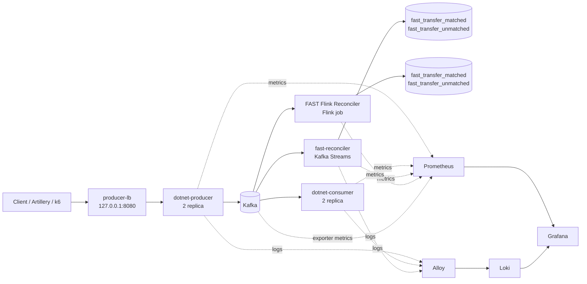

# FAST Transfer Events Lab

Bu proje, FAST transfer event’lerinin Kafka üzerinden taşınmasını, iki farklı reconciliation uygulamasıyla eşleştirilmesini ve Grafana’da gözlemlenmesini gösteren yerel bir laboratuvar ortamıdır.

Projeyi yeni açan bir geliştirici için en önemli fikir şudur:

> Producer `fast_send` event’ini yayınlar. Daha sonra aynı `transaction_id` için başarı veya hata sonucu gelir. Kafka Streams ve Flink reconciler’ları bu iki event’i eşleştirir, sonucu topic’lere yazar ve iş metrikleri üretir.

## İçindekiler

- [Mimariyi hızlıca anlama](#mimariyi-hızlıca-anlama)
- [Servisler](#servisler)
- [Event akışı](#event-akışı)
- [Projeyi çalıştırma](#projeyi-çalıştırma)
- [Test transferi gönderme](#test-transferi-gönderme)
- [Reconciler’lar](#reconcilerlar)
- [Grafana ve gözlemlenebilirlik](#grafana-ve-gözlemlenebilirlik)
- [Prometheus metrikleri](#prometheus-metrikleri)
- [Kalıcı volume klasörleri](#kalıcı-volume-klasörleri)
- [Proje yapısı](#proje-yapısı)
- [Performans testleri](#performans-testleri)
- [Geliştirme ve test](#geliştirme-ve-test)
- [Sorun giderme](#sorun-giderme)

## Mimariyi hızlıca anlama



Kafka Streams ve Flink reconciler’ları birbirinin yerine kullanılabilir iki ayrı uygulamadır. Karşılaştırma yapılabilmesi için ikisi de aynı input topic’lerini okur, aynı output topic sözleşmesini izler ve FAST iş metriklerini aynı mantıksal isimlerle üretir.

## Servisler

| Servis | Teknoloji | Görevi | Adres / port |
|---|---|---|---|
| `kafka` | Apache Kafka 4.4 | Event ve output topic’lerini taşır | `localhost:9092` |
| `kafka-init` | Kafka CLI | Gerekli topic’leri oluşturur | Tek seferlik servis |
| `dotnet-producer` | .NET 10 | HTTP event API’si ve Kafka producer | İç port `8080` |
| `producer-lb` | nginx | Producer replica’ları için tek giriş noktası | `http://127.0.0.1:8080` |
| `dotnet-consumer` | .NET 10 | Input event’lerini tüketen örnek consumer | `2114`, `2115` |
| `fast-reconciler` | Java 21 / Kafka Streams | FAST event’lerini eşleştirir | `9400`, `9401` metrics |
| `flink-jobmanager` | Apache Flink 2.1.3 | Flink cluster yönetimi ve REST API | `http://localhost:18082` |
| `flink-taskmanager` | Apache Flink 2.1.3 | Flink job task’lerini çalıştırır | Metrics portu `9249` |
| `flink-reconciler-submit` | Flink CLI | FAST Flink job’unu cluster’a submit eder | Tek seferlik servis |
| `kafka-exporter` | kafka-exporter | Consumer group lag ve offset metrikleri | `9308` |
| `kafka-jmx-exporter` | JMX exporter | Kafka broker metrikleri | `5556` |
| `prometheus` | Prometheus | Metrikleri scrape eder ve saklar | `http://localhost:9090` |
| `loki` | Loki | Logları saklar | `http://localhost:3100` |
| `alloy` | Grafana Alloy | Docker loglarını Loki’ye gönderir | Internal |
| `grafana` | Grafana | Dashboard ve alert ekranı | `http://localhost:3000` |

`dotnet-producer`, `dotnet-consumer` ve Kafka Streams reconciler’ı Compose içinde iki replica ile çalışır. Flink tarafında ise bir JobManager, bir TaskManager ve bir `FAST Flink Reconciler` job’u vardır.

## Event akışı

### Input topic’leri

| Event | HTTP endpoint | Kafka topic | Anlamı |
|---|---|---|---|
| `fast_send` | `POST /events/fast_send` | `fast_send` | Transfer başlatıldı |
| `fast_send_success` | `POST /events/fast_send_success` | `fast_send_success` | Transfer başarılı |
| `fast_send_failed` | `POST /events/fast_send_failed` | `fast_send_failed` | Transfer başarısız |

Her event’in Kafka message key’i `transaction_id` değeridir. Reconciler’lar bu key’i kullanarak event’leri aynı transfer altında birleştirir.

### Output topic’leri

| Topic | İçerik |
|---|---|
| `fast_transfer_matched` | `fast_send` ile başarı/hata sonucunun eşleştiği transferler |
| `fast_transfer_unmatched` | TTL sonunda eşleşemeyen transferler |

## Projeyi çalıştırma

Gereksinimler:

- Docker Desktop
- Docker Compose v2
- Performans testleri için Node.js ve npm
- Docker dışında Java testleri için JDK 21 ve Maven

Tüm stack’i başlatmak için:

```powershell
docker compose up -d --build
```

Durumu kontrol etmek için:

```powershell
docker compose ps
docker compose logs -f fast-reconciler
docker compose logs -f flink-jobmanager
```

Flink job listesini görmek için:

```powershell
Invoke-RestMethod http://localhost:18082/jobs/overview
```

Flink UI: [http://localhost:18082](http://localhost:18082)

Grafana varsayılan giriş bilgileri:

- Kullanıcı: `admin`
- Şifre: `admin`

Grafana anonim erişime de açıktır; dashboard’ları [http://localhost:3000](http://localhost:3000) üzerinden açabilirsiniz.

## Test transferi gönderme

Önce bir `fast_send` event’i gönderin:

```powershell
Invoke-RestMethod -Method Post `
  -Uri http://127.0.0.1:8080/events/fast_send `
  -ContentType 'application/json' `
  -Body '{"transaction_id":"tx-1001","amount":1250.75,"currency":"TRY","sender_bank":"00010","receiver_bank":"00046"}'
```

Aynı `transaction_id` için başarı sonucu gönderin:

```powershell
Invoke-RestMethod -Method Post `
  -Uri http://127.0.0.1:8080/events/fast_send_success `
  -ContentType 'application/json' `
  -Body '{"transaction_id":"tx-1001","amount":1250.75,"sender_bank":"00010","receiver_bank":"00046"}'
```

Başarısız sonuç için:

```powershell
Invoke-RestMethod -Method Post `
  -Uri http://127.0.0.1:8080/events/fast_send_failed `
  -ContentType 'application/json' `
  -Body '{"transaction_id":"tx-1002","amount":500,"currency":"TRY","sender_bank":"00010","receiver_bank":"00046","failure_reason":"INSUFFICIENT_BALANCE"}'
```

Başarılı HTTP kabulü `202`, geçersiz body `400`, bilinmeyen event `404`, Kafka yazma hatası `503` döndürür.

## Reconciler’lar

### Kafka Streams reconciler

Kaynak: [reconciler/](./reconciler/)

Kafka Streams uygulaması `fast_send`, `fast_send_success` ve `fast_send_failed` topic’lerini okur. State, `transaction_id` ile keyed store’da tutulur. RocksDB local state’i Kafka changelog topic’i ile desteklenir; bu nedenle instance yeniden başlatıldığında state tekrar oluşturulabilir.

Önemli ayarlar:

| Environment variable | Varsayılan | Açıklama |
|---|---:|---|
| `KAFKA_BROKERS` | `kafka:9092` | Kafka adresi |
| `APPLICATION_ID` | `fast-reconciler` | Kafka Streams application ID / consumer group |
| `FAST_PENDING_THRESHOLD` | `30s` | Bu süreden uzun bekleyen transfer stuck sayılır |
| `FAST_MATCH_TTL` | `10m` | Bu sürede eşleşmeyen transfer unmatched olur |
| `FAST_SCAN_INTERVAL` | `5s` | State tarama sıklığı |
| `NUM_STANDBY_REPLICAS` | `1` | Standby task sayısı |
| `PROCESSING_GUARANTEE` | `exactly_once_v2` | Kafka Streams processing guarantee |
| `REPARTITION_PARTITIONS` | `3` | Internal repartition topic partition sayısı |

### Flink reconciler

Kaynak: [flink-reconciler/](./flink-reconciler/)

Flink job’un entry point’i [FlinkReconcilerJob.java](./flink-reconciler/src/main/java/fast/reconciler/flink/FlinkReconcilerJob.java) dosyasıdır. Job şu adımları izler:

1. Üç input topic’ini Kafka source ile okur.
2. `transaction_id` ile keyBy yapar.
3. `FlinkReconciliationFunction` içinde event’leri eşleştirir.
4. `fast_transfer_matched` veya `fast_transfer_unmatched` topic’ine exactly-once sink ile yazar.
5. 10 saniyelik checkpoint ile state’i checkpoint klasörüne kaydeder.

Flink ortam değişkenleri:

| Environment variable | Varsayılan | Açıklama |
|---|---:|---|
| `KAFKA_BROKERS` | `kafka:9092` | Kafka adresi |
| `APPLICATION_ID` | `fast-flink-reconciler` | Kafka source consumer group |
| `FAST_PENDING_THRESHOLD` | `30s` | Stuck eşiği |
| `FAST_MATCH_TTL` | `10m` | Unmatched TTL |
| `CHECKPOINT_INTERVAL` | `10s` | Checkpoint aralığı |
| `PARALLELISM` | `3` | Flink job parallelism’i |

Flink job’unu kontrol etmek için:

```powershell
Invoke-RestMethod http://localhost:18082/jobs/overview
```

Beklenen job adı `FAST Flink Reconciler`, beklenen durum `RUNNING` olmalıdır.

## Grafana ve gözlemlenebilirlik

Grafana dashboard’ları dosyadan provision edilir. Elle dashboard oluşturmak yerine JSON dosyasını güncellemek gerekir.

| Klasör | Dashboard | Ne için kullanılır |
|---|---|---|
| `FAST` | FAST Operations - Kafka Streams | Kafka Streams reconciler iş metrikleri |
| `FAST` | FAST Operations - Flink | Flink reconciler iş metrikleri |
| `FAST` | FAST Services | Producer, consumer ve Kafka Streams servis sağlığı |
| `Flink` | Flink Infrastructure | Job sayısı, çalışan job listesi, uptime, slot, checkpoint ve TaskManager kaynakları |
| `Kafka` | Kafka Consumer Groups & Broker | Kafka lag, partition ve broker sağlığı |

Dashboard dosyaları:

- [fast-operations-kstreams.json](./observability/grafana/dashboards/FAST/fast-operations-kstreams.json)
- [fast-operations-flink.json](./observability/grafana/dashboards/FAST/fast-operations-flink.json)
- [fast-services.json](./observability/grafana/dashboards/FAST/fast-services.json)
- [flink-infrastructure.json](./observability/grafana/dashboards/Flink/flink-infrastructure.json)
- [kafka-consumer-groups.json](./observability/grafana/dashboards/Kafka/kafka-consumer-groups.json)

### Hangi dashboard’a bakılmalı?

- Transfer sayısı, başarı oranı veya banka bazlı hata: `FAST Operations`.
- API, consumer replica veya Kafka Streams instance sorunu: `FAST Services`.
- Flink job çalışıyor mu, kaç job var, checkpoint veya slot problemi var mı: `Flink Infrastructure`.
- Kafka’da lag veya broker problemi: `Kafka Consumer Groups & Broker`.

Kafka Streams ve Flink iş dashboard’ları ayrı tutulur. Her biri kendi implementation’ının sabit metric kaynağını kullanır; bu nedenle dashboard’da implementation, consumer group veya reconciler seçmek gerekmez.

### Alert listesi

Provision edilen alert’lerin tamamı [fast-alerts.yml](./observability/grafana/provisioning/alerting/fast-alerts.yml) dosyasındadır. Grafana’da `Alerting` menüsünden veya `FAST` klasöründen aynı listeyi görebilirsiniz.

| Alert | Koşul | Severity | Firing süresi | Kaynak |
|---|---|---|---|---|
| `FAST send/outcome mismatch` | Son 5 dakikada send ve outcome farkı `%10` üstü | warning | 5 dakika | `fast-transfer-consumers-dotnet` offset’leri |
| `FAST send volume low (business hours)` | İstanbul mesai saatlerinde son 5 dakikada `100`’den az send | warning | 5 dakika | Kafka consumer group offset’leri |
| `FAST send volume high` | Son 5 dakikada `6000`’den fazla send | critical | 5 dakika | Kafka consumer group offset’leri |
| `FAST outcome volume low (business hours)` | İstanbul mesai saatlerinde son 5 dakikada `100`’den az outcome | warning | 5 dakika | Kafka consumer group offset’leri |
| `FAST outcome volume high` | Son 5 dakikada `6000`’den fazla outcome | critical | 5 dakika | Kafka consumer group offset’leri |
| `FAST failed count high` | Son 5 dakikada `500`’den fazla failed outcome | critical | 5 dakika | Kafka consumer group offset’leri |
| `FAST failed/success ratio high` | `failed / success` oranı `%20` üstü | critical | 5 dakika | Kafka consumer group offset’leri |
| `FAST stuck transfers high` | 30 saniyeden uzun bekleyen `50`’den fazla transfer | warning | 5 dakika | Kafka Streams reconciler metrikleri |
| `FAST reconciler down` | RUNNING durumda Kafka Streams instance kalmaması | critical | 2 dakika | Kafka Streams client state |

Önemli noktalar:

- Düşük hacim alert’leri yalnızca İstanbul saatiyle `09:00–18:00` arasında değerlendirilir.
- İlk yedi alert `fast-transfer-consumers-dotnet` consumer group’unun Kafka offset’lerine dayanır. Bu nedenle reconciler durmuş olsa bile hacim alert’leri çalışabilir.
- `FAST stuck transfers high` ve `FAST reconciler down` Kafka Streams reconciler’a özeldir.
- Şu anda Flink job için ayrı bir Grafana alert kuralı yoktur; Flink durumu `Flink Infrastructure` dashboard’undan izlenir.
- Koşul ilk sağlandığında alert `Pending` olur. `for` süresi boyunca devam ederse `Firing` olur.
- Alert’ler Grafana’da görünür; Slack veya e-posta gönderimi için ayrıca contact point ve notification policy tanımlanmalıdır.

## Prometheus metrikleri

Prometheus scrape ayarları [observability/prometheus.yml](./observability/prometheus.yml) dosyasındadır. Genel scrape aralığı 5 saniyedir.

Ana kaynaklar:

| Kaynak | Metrik tipi |
|---|---|
| Producer | `producer_*`, HTTP ve .NET runtime metrikleri |
| Consumer | `consumer_*`, Kafka tüketim ve .NET runtime metrikleri |
| Kafka Streams reconciler | `fast_kstreams_reconciler_*`, Kafka Streams ve JVM metrikleri |
| Flink reconciler | Flink TaskManager metric reporter’ı ve normalize edilmiş `fast_kstreams_reconciler_*` metrikleri |
| Kafka exporter | Consumer group lag, offset ve üyelik metrikleri |
| Kafka JMX exporter | Broker ve partition metrikleri |

Flink’in Prometheus reporter’ı MetricGroup boyutlarını metric adının içine taşıdığı için Prometheus scrape konfigürasyonunda normalize edilir. Böylece Flink ve Kafka Streams iş metrikleri aynı dashboard sorgu sözleşmesini kullanabilir.

Prometheus recording rule’ları [observability/prometheus/rules/fast.yml](./observability/prometheus/rules/fast.yml) dosyasındadır. Bunlar özellikle consumer group bazlı son 5 dakikalık hacim, başarı/başarısızlık oranı ve send/outcome mismatch hesapları için kullanılır.

## Kalıcı volume klasörleri

Kalıcı veriler proje altındaki [volumes/](./volumes/) klasöründe tutulur. Bu klasörlerin içeriği `.gitignore` ile Git dışında bırakılır.

| Klasör | Kullanıldığı servis | İçerik |
|---|---|---|
| `volumes/kafka` | Kafka | Kafka log segmentleri ve KRaft metadata |
| `volumes/flink-checkpoints` | Flink servisleri | Flink checkpoint state’i |
| `volumes/prometheus` | Prometheus | Time-series database verisi |
| `volumes/loki` | Loki | Log index ve chunk verisi |
| `volumes/alloy` | Alloy | Alloy agent state’i |
| `volumes/grafana` | Grafana | Grafana database ve state’i |

Producer, consumer, exporter ve load balancer servisleri stateless’tir; bu nedenle onlar için gereksiz kalıcı data volume oluşturulmamıştır. Kafka Streams local RocksDB state’i changelog topic’i ile yeniden oluşturulabildiği için iki replica arasında ortak bir klasör paylaşılmaz.

## Proje yapısı

```text
dotnet/
  FastTransfer.Shared/       Ortak FAST modelleri ve yardımcıları
  FastTransfer.Producer/     HTTP API → Kafka producer
  FastTransfer.Consumer/     Kafka consumer ve teknik metrikler

reconciler/                  Java Kafka Streams reconciler
  src/main/                   Topology, state store ve business metrics
  src/test/                   TopologyTestDriver testleri

flink-reconciler/            Apache Flink reconciler
  src/main/                   Flink job, process function ve metrics
  src/test/                   Flink reconciliation testleri
  conf/                       Flink runtime config

observability/
  prometheus.yml             Prometheus scrape ayarları
  prometheus/rules/           Recording rules
  grafana/dashboards/         Dashboard JSON dosyaları
  grafana/provisioning/       Datasource, dashboard ve alert provisioning
  loki/                       Loki config
  alloy/                      Alloy config
  kafka-jmx-exporter/         Kafka JMX exporter config
  nginx/                      Producer load balancer config

performance/
  artillery/                  Artillery senaryoları ve raporları
  producer.js                 k6 producer yük testi

volumes/                      Local persistent data; Git tarafından ignore edilir
docker-compose.yml            Local stack tanımı
dashboard.md                 Dashboard ve alert ayrıntıları
```

## Performans testleri

Artillery testleri [performance/artillery/](./performance/artillery/) altındadır. Kurulum:

```powershell
cd performance/artillery
npm install
```

Testler çalışırken ana stack’in hazır olması gerekir. Testler producer endpoint’i üzerinden event gönderir ve raporları `performance/artillery/reports/` altına JSON olarak yazar.

| Komut | Senaryo |
|---|---|
| `npm run test:both-open` | Normal send → success/failed akışı |
| `npm run test:fast-send-backlog` | Outcome olmadan send backlog oluşturma |
| `npm run test:no-fast-send` | Yalnızca outcome event’leri |
| `npm run test:missing-outcomes` | Send/outcome mismatch alarmı |
| `npm run test:high-failure` | Yüksek failed oranı |
| `npm run test:fast-send-spike` | Yüksek trafik |
| `npm run test:low-volume` | Düşük trafik |
| `npm run test:consumer-only` | Consumer `/metrics` endpoint kontrolü |
| `npm run test:all` | Tüm senaryoları sırayla çalıştırır |

Basit k6 testi:

```powershell
k6 run performance/producer.js
$env:PRODUCER_URL = "http://127.0.0.1:8080"
k6 run performance/producer.js
```

Performance testleri sırasında Docker image build, stack yeniden kurma, health check veya servis durumu değiştirme yapılmaz. Test hedeflerinin önceden hazırlanmış olması beklenir; Artillery runner senaryoyu doğrudan çalıştırır. `fast-send-backlog` gibi servis durumu gerektiren senaryolar için servisleri testten önce manuel olarak hazırlayın. Alert senaryolarını aynı anda çalıştırmayın; trafik ve alarm sinyalleri birbirine karışabilir.

## Geliştirme ve test

### .NET

```powershell
dotnet build dotnet/FastTransfer.slnx
dotnet test dotnet/FastTransfer.slnx
```

### Kafka Streams

```powershell
cd reconciler
mvn test
```

### Flink

```powershell
cd flink-reconciler
mvn test
mvn package -DskipTests
```

Java testleri `TopologyTestDriver` ve Flink test harness ile local çalışır; Docker üzerinden test çalıştırmak gerekmez.

## Sorun giderme

### Grafana dashboard görünmüyor

1. Grafana container’ının çalıştığını kontrol edin.
2. Dashboard JSON’unun geçerli JSON olduğunu kontrol edin.
3. Provisioning dosyasını kontrol edin: [dashboards.yml](./observability/grafana/provisioning/dashboards/dashboards.yml).
4. Grafana’yı yeniden başlatın:

```powershell
docker compose restart grafana
```

### Flink job görünmüyor

```powershell
Invoke-RestMethod http://localhost:18082/overview
Invoke-RestMethod http://localhost:18082/jobs/overview
docker compose logs --tail=100 flink-jobmanager
docker compose logs --tail=100 flink-reconciler-submit
```

Beklenen job adı `FAST Flink Reconciler`, durumu `RUNNING` olmalıdır.

### Metrik var ama dashboard boş

Önce Prometheus target durumunu kontrol edin:

```powershell
Invoke-RestMethod http://localhost:9090/api/v1/targets
```

Flink için JobManager ve TaskManager target’larının `up` olması gerekir. Flink iş metrikleri yalnızca ilgili event işlendiğinde oluşabilir; sabit altyapı metrikleri ise job çalışır çalışmaz görünür.

### Kafka output topic’ini okumak

```powershell
docker compose exec kafka /opt/kafka/bin/kafka-console-consumer.sh `
  --bootstrap-server localhost:9092 `
  --topic fast_transfer_unmatched `
  --from-beginning `
  --consumer-property isolation.level=read_committed
```

## Sürümler

| Bileşen | Sürüm |
|---|---|
| Apache Kafka | 4.4.0 |
| Apache Flink | 2.1.3 |
| Flink Kafka connector | 5.0.0-2.1 |
| Prometheus | 3.13.1 |
| Grafana | 13.3.0 |
| Loki | 3.7.9 |
| Grafana Alloy | 1.21.3 |
| nginx | 1.29.3-alpine |
| kafka-exporter | 1.9.0 |
| .NET | 10 |
| Java | 21 |

Dashboard panel açıklamaları, alert eşikleri ve yeni metrik/panel ekleme rehberi için [dashboard.md](./dashboard.md) dosyasına bakın.
