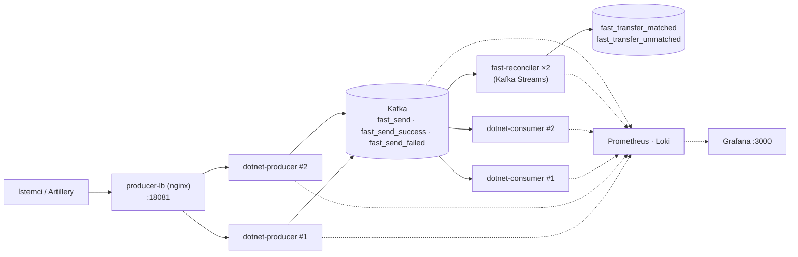

# FAST Transfer Events: Kafka + Grafana Lab

FAST (Fonların Anlık ve Sürekli Transferi) para transferi event'lerini Kafka üzerinden taşıyan ve Grafana ile izleyen örnek bir proje.

- **Uygulama:** C# (.NET 10) producer ve consumer; ikisi de 2 replica ile çalışır.
- **Mutabakat:** Java Kafka Streams servisi (`fast-reconciler`, 2 instance). Her `fast_send`'i sonucuyla eşleştirir ve FAST iş metriklerini üretir: tamamlanma süresi, banka, tutar, takılı transferler.
- **Altyapı:** Kafka; Prometheus ve Loki ile metrik ve log toplama.
- **İzleme:** Grafana dashboard'ları ve alarmları.
- **Yük testi:** Artillery ve k6.



## Hızlı başlangıç

Docker ve Docker Compose gerekir:

```bash
docker compose up -d --build
```

| Servis | Adres |
|---|---|
| Producer API (load balancer) | http://localhost:18081 |
| Grafana | http://localhost:3000 (admin / admin) |
| Prometheus | http://localhost:9090 |
| Consumer metrikleri (replica başına) | http://localhost:2114/metrics, http://localhost:2115/metrics |
| Reconciler metrikleri (instance başına) | http://localhost:9400/metrics, http://localhost:9401/metrics |
| kafka-exporter | http://localhost:9308/metrics |
| Loki | http://localhost:3100 |

Bir transfer gönderip sonucunu bildirmek:

```bash
curl -X POST http://localhost:18081/events/fast_send \
  -H "Content-Type: application/json" \
  -d '{"transaction_id":"tx-1001","amount":1250.75,"currency":"TRY","sender_bank":"00010","receiver_bank":"00046"}'

curl -X POST http://localhost:18081/events/fast_send_success \
  -H "Content-Type: application/json" \
  -d '{"transaction_id":"tx-1001","amount":1250.75,"sender_bank":"00010","receiver_bank":"00046"}'
```

Ardından Grafana'da `FAST / FAST Operations` dashboard'unu açın.

## FAST event'leri

| Event | Endpoint | Kafka topic | Anlamı |
|---|---|---|---|
| `fast_send` | `POST /events/fast_send` | `fast_send` | Transfer gönderildi |
| `fast_send_success` | `POST /events/fast_send_success` | `fast_send_success` | Transfer başarıyla tamamlandı |
| `fast_send_failed` | `POST /events/fast_send_failed` | `fast_send_failed` | Transfer başarısız oldu |

Body alanları:

| Alan | Zorunlu | Açıklama |
|---|---|---|
| `transaction_id` | Evet | Transferin kimliği; Kafka message key'i olarak da kullanılır |
| `amount` | Evet | TRY tutar, 0'dan büyük olmalı |
| `currency` | Hayır | Yalnızca `TRY` kabul edilir (varsayılan) |
| `failure_reason` | `fast_send_failed` için evet | Ör. `INSUFFICIENT_BALANCE` |
| `sender_bank`, `receiver_bank` | Hayır | 5 haneli banka kodu (ör. `00010`). Boşsa IBAN'dan okunur. |
| `sender_iban`, `receiver_iban`, `description`, `sent_at`, `source` | Hayır | Bilgi amaçlı |

Yanıtlar:

- `202`: event Kafka'ya yazıldı.
- `400`: geçersiz body (eksik alan, `TRY` dışı para birimi, bozuk JSON).
- `404`: bilinmeyen event adı.
- `503`: Kafka'ya yazılamadı.

Her event kendi topic'ine (3 partition) yazılır.

## Proje yapısı

```
dotnet/
  FastTransfer.Shared/     FAST modelleri, ortam değişkeni yardımcıları
  FastTransfer.Producer/   HTTP API → Kafka                         (+ Dockerfile)
  FastTransfer.Consumer/   Kafka → iş işleme ve teknik metrikler    (+ Dockerfile)
reconciler/                Java 21 / Kafka Streams: eşleştirme ve FAST iş metrikleri (+ Dockerfile, testler)
observability/
  prometheus.yml           scrape ayarları (replica'lar Docker DNS ile bulunur)
  prometheus/rules/        FAST recording rule'ları (alarmların temeli)
  grafana/dashboards/      FAST/ ve Kafka/ klasörlerindeki dashboard JSON'ları
  grafana/provisioning/    veri kaynakları, dashboard sağlayıcısı, alarmlar
  nginx/                   producer load balancer ayarı
  alloy/, loki/            log toplama
  kafka-jmx-exporter/      broker metrikleri
performance/
  artillery/               senaryolu yük ve alarm testleri
  producer.js              k6 yük testi
docker-compose.yml
dashboard.md               dashboard'lar, alarmlar ve veri akışı
```

## Mutabakat: fast-reconciler (Kafka Streams)

Bir transferin `fast_send`'i ile sonucunu (`fast_send_success` / `fast_send_failed`) eşleştirmek **durum** (state) gerektirir: önce gelen taraf, diğeri gelene kadar bir yerde tutulmalıdır. Bu iş [reconciler/](./reconciler/) altındaki Java Kafka Streams servisinde yapılır:

```
fast_send ─────────┐
fast_send_success ─┼─► transaction_id'ye göre repartition ─► eşleştirici ─┬─► fast_transfer_matched   (süre, sonuç, banka, tutar)
fast_send_failed ──┘                                     [RocksDB state    └─► fast_transfer_unmatched (10 dk'da eşleşmeyenler)
                                                          + changelog]
```

- **Kalıcı durum:** state RocksDB'de tutulur ve Kafka'daki bir changelog topic'ine yedeklenir. Instance yeniden başlasa, eklense veya azaltılsa bile yarım kalan eşleşmeler kaybolmaz; partition ile birlikte yeni instance'a taşınır. Taşımayı `NUM_STANDBY_REPLICAS=1` hızlandırır.
- **Producer'dan bağımsız:** girdi `transaction_id`'ye göre yeniden bölümlenir. Bu yüzden producer'ların partitioner'ı veya topic partition sayıları eşleşmeyi etkilemez.
- **Exactly-once:** `exactly_once_v2` ile her transfer çıktı topic'lerine tam bir kez yazılır.
- **Bilgi fast_send'den gelir:** banka ve tutar her zaman `fast_send`'den alınır. Sonuç event'leri yalnızca `transaction_id` taşısa bile banka ve tutar bazında doğru sayılar çıkar.
- **Süre event zamanına göre:** tamamlanma süresi iki event'in Kafka'ya yazılma zamanından hesaplanır. Okuma sırasından (ör. backlog boşalırken) etkilenmez.
- **Takılı / eşleşmeyen transferler:** her 5 saniyede state taranır. 30 sn'den uzun bekleyenler "takılı" sayılır. 10 dakikada eşleşmeyenler `fast_transfer_unmatched` topic'ine `transaction_id` ile yazılır.

Test edildi: yük altında reconciler 2 → 1 → 2 instance'a indirilip çıkarıldı. 900 transferin 900'ü eşleşti; eşleşmeyen, bekleyen ve tekrar eden 0. Birim testleri `TopologyTestDriver` ile Docker build sırasında çalışır.

| Ortam değişkeni | Varsayılan | Anlamı |
|---|---|---|
| `APPLICATION_ID` | `fast-reconciler` | Kafka Streams uygulama kimliği (consumer group adı da budur) |
| `FAST_PENDING_THRESHOLD` | `30s` | Bu süreden uzun sonuç bekleyen transfer "takılı" sayılır |
| `FAST_MATCH_TTL` | `10m` | Bu sürede eşleşmeyen kayıt `fast_transfer_unmatched`'e yazılır |
| `FAST_SCAN_INTERVAL` | `5s` | State tarama sıklığı |
| `NUM_STANDBY_REPLICAS` | `1` | Her task'ın yedek kopya sayısı (hızlı devralma için) |
| `PROCESSING_GUARANTEE` | `exactly_once_v2` | `at_least_once` da kullanılabilir |
| `REPARTITION_PARTITIONS` | `3` | İç repartition topic'inin partition sayısı = en fazla paralel instance |

Çıktı topic'lerini okumak:

```bash
docker compose exec kafka /opt/kafka/bin/kafka-console-consumer.sh --bootstrap-server localhost:9092 \
  --topic fast_transfer_unmatched --from-beginning --consumer-property isolation.level=read_committed
```

**Sayımlar için not:** çıktı topic'leri exactly-once ile yazıldığı için offset'leri transaction işaretlerini de içerir. Kayıt sayısı offset farkından **hesaplanamaz**. Sayılar reconciler metriklerinden, tek tek kayıtlar topic'lerden okunur.

### Banka listesi

Banka listesi [Banks.java](./reconciler/src/main/java/fast/reconciler/Banks.java) içindedir: 18 banka ve elektronik para kuruluşu.

- **Kodun kaynağı:** `sender_bank` / `receiver_bank` alanı; boşsa IBAN'ın 5–9. haneleri.
- **Listede olmayan kodlar** `other` olarak raporlanır. Bu, metrik sayısının sınırsız büyümesini önler.
- **Enpara.com** QNB'nin kodunu (00111) kullandığı için ayırt edilemez; ikisi `QNB / Enpara.com` olarak birlikte görünür.

## Ölçekleme

Tüm uygulama servisleri `docker-compose.yml` içinde `deploy.replicas: 2` ile çalışır.

| Servis | Nasıl dağılır | Not |
|---|---|---|
| `dotnet-producer` | Önünde `producer-lb` (nginx), tek giriş noktası http://localhost:18081 | nginx Docker DNS'i 5 sn'de bir yeniden çözer; replica eklenip çıkarılınca yeniden başlatma gerekmez. Yanıttaki `X-Upstream` header'ı isteği karşılayan replica'yı gösterir. |
| `dotnet-consumer` | Aynı consumer group (`fast-transfer-consumers-dotnet`), cooperative-sticky assignor | Event'ler arası durum tutmadığı için atama şekli önemsizdir. Rebalance'lar kademeli olur. |
| `fast-reconciler` | Kafka Streams task'ları instance'lara dağıtılır | State, partition ile birlikte taşınır (bkz. yukarı) |

Replica sayısını değiştirmek için `deploy.replicas` değerini güncelleyin. Consumer (`2114-2115`) ve reconciler (`9400-9401`) için host port aralığını da genişletin. Partition sayısından (3) fazla consumer veya reconciler instance'ı boşta kalır.

## İzleme ve alarmlar

Grafana'da iki klasör vardır:

| Klasör | Dashboard | Kimin için |
|---|---|---|
| FAST | **FAST Operations** | İş / operasyon: hacim, başarı oranı, tamamlanma süresi, bankalar, para, alarmlar |
| FAST | **FAST Services** | Uygulama ekibi: API, consumer replica'ları, runtime, loglar |
| Kafka | **Kafka Consumer Groups & Broker** | Platform: lag, partition'lar, broker sağlığı |

9 FAST alarmı vardır:

- **Hacim:** mesai saatinde düşük `fast_send` veya sonuç hacmi; her zaman yüksek hacim.
- **Hata:** başarısız sayısı ve `failed / success` oranı.
- **Eşleşme:** sonucu gelmeyen transferler (send/outcome mismatch) ve 30 sn'den uzun bekleyen takılı transferler.
- **Altyapı:** reconciler'ın çalışmaması.

Her panelin ne gösterdiği ve neden konulduğu, alarmların eşikleri ve çaldığında nereye bakılacağı, verinin Grafana'ya nasıl geldiği ve yeni metrik, panel veya alarm eklemenin adımları **[dashboard.md](./dashboard.md)** içinde anlatılır.

Alarmlar için henüz bildirim kanalı yok. Slack veya e-posta için Grafana'da bir contact point tanımlanmalıdır.

## Yük ve alarm testleri

Artillery senaryoları servisleri gereken duruma getirir, yükü gönderir ve rapor üretir (ör. consumer kapalıyken `fast_send` biriktirmek). Ayrıntılar: [performance/artillery/README.md](./performance/artillery/README.md).

```bash
cd performance/artillery
npm install
npm run test:both-open          # normal akış
npm run test:fast-send-backlog  # consumer kapalı, fast_send birikir
npm run test:no-fast-send       # sadece sonuç event'leri
npm run test:missing-outcomes   # mismatch alarmını tetikler (8 dk)
```

k6 ile basit yük testi:

```bash
k6 run performance/producer.js                                     # varsayılan: http://localhost:18081
PRODUCER_URL=http://localhost:18081 k6 run performance/producer.js
```

## İmaj sürümleri

| Bileşen | Sürüm |
|---|---|
| Apache Kafka | 4.4.0 |
| Prometheus | 3.13.1 |
| Grafana | 13.3.0 |
| Loki | 3.7.9 |
| Grafana Alloy | 1.21.3 |
| nginx | 1.29.3 |
| kafka-exporter | 1.9.0 |
| .NET | 10 (SDK / ASP.NET Core runtime) |
| Java / Kafka Streams | 21 (Temurin) / 4.4.0 |

## Notlar

- Consumer'da gerçek iş mantığı yoktur. Transfer işleme adımı `ConsumerWorker.Handle` içine eklenebilir.
- Reconciler'ın birim testlerini yerelde çalıştırmak için (JDK gerekmez): `docker build --target build reconciler/`.
- Projenin ilk sürümü Go ile yazılmıştı; git geçmişinde duruyor. O sürümün consumer group'u (`fast-transfer-consumers`) Kafka verisinde kaldıysa silmek için:

  ```bash
  docker compose exec kafka /opt/kafka/bin/kafka-consumer-groups.sh \
    --bootstrap-server localhost:9092 --delete --group fast-transfer-consumers
  ```
