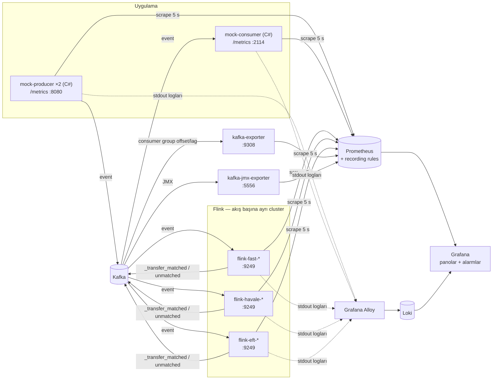

# Dashboard'lar ve alarmlar

Bu doküman FAST, Havale ve EFT transfer akışlarının Grafana'da nasıl izlendiğini anlatır:

1. Verinin Grafana'ya nasıl geldiği.
2. Hangi ekibin hangi panoya baktığı ve panoların ne gösterdiği.
3. Alarmların ne zaman, neden çaldığı ve çaldığında nereye bakılacağı.
4. Yeni metrik, panel veya alarm eklemek.

Grafana: http://localhost:3000 (admin/admin).

- [Klasörler ve panolar](#klasörler-ve-panolar)
- [1. Veri Grafana'ya nasıl geliyor](#1-veri-grafanaya-nasıl-geliyor)
- [2. Ekip panoları](#2-ekip-panoları)
  - [İş Birimi](#iş-birimi)
  - [Geliştirici](#geliştirici)
  - [SRE](#sre)
- [3. Platform panoları](#3-platform-panoları)
- [4. Alarmlar](#4-alarmlar)
- [5. Demo akışı](#5-demo-akışı)
- [6. Yeni metrik, panel veya alarm eklemek](#6-yeni-metrik-panel-veya-alarm-eklemek)
- [7. Bilinen kısıtlar](#7-bilinen-kısıtlar)

---

## Klasörler ve panolar

Her akışın kendi Grafana klasörü vardır; her klasörde aynı yapıda üç ekip panosu bulunur. Ortak altyapı `Platform` klasöründedir.

| Klasör | Pano | Kimin için | Cevapladığı soru |
|---|---|---|---|
| `FAST`, `Havale`, `EFT` | `<Akış> · İş Birimi` | İş birimi, ürün sahipleri | Transferler başarılı mı? Ne kadar para geçti? Hangi banka, hangi neden sorunlu? |
| | `<Akış> · Geliştirici` | Geliştirme ekibi | Event'ler API'den Kafka'ya, oradan reconciler'a sorunsuz akıyor mu? Hata, gecikme, duplicate nerede? |
| | `<Akış> · SRE` | SRE / operasyon | Servis ayakta mı, SLO'lar tutuyor mu? Checkpoint, lag, backpressure, kaynak sorunu var mı? |
| `Platform` | `Platform · Servisler` | Platform ekibi | Mock API ve consumer replikaları sağlıklı mı? Yük replikalara dengeli dağılıyor mu? |
| | `Platform · Flink (tüm akışlar)` | Platform ekibi, SRE | Üç Flink cluster'ından hangisi sorunlu? |
| | `Platform · Kafka` | Platform ekibi | Kafka geride kalıyor mu? Hangi partition birikiyor, broker sağlıklı mı? |

Panoların sol üstündeki menüler aynı akışın diğer panolarına, tüm akış panolarına ve platform panolarına geçiş sağlar (zaman aralığı korunur).

Ekip panoları ve Platform · Servisler / Flink panoları [generate_team_dashboards.py](./observability/grafana/generate_team_dashboards.py) ile üretilir; JSON elle düzenlenmez (bkz. [bölüm 6](#d-panel-eklemek)). `Platform · Kafka` elle bakımı yapılan JSON'dur.

---

## 1. Veri Grafana'ya nasıl geliyor



| Kaynak | Ne üretir | Nasıl toplanır | Kullanıldığı panolar |
|---|---|---|---|
| **Producer** (`mock-producer`, 2 replika) | HTTP istek sayısı ve süresi (endpoint başına), Kafka'ya yazılan event ve TRY tutarı, hatalar, .NET runtime | `prometheus-net` ile `/metrics`; Prometheus her replikayı Docker DNS ile ayrı bulur (`dns_sd_configs`) | Geliştirici, SRE (API SLO), Platform · Servisler |
| **Consumer** (`mock-consumer`) | Tüketilen event, hatalar, Kafka → consumer gecikmesi, partition dağılımı, runtime | Producer ile aynı | Geliştirici, Platform · Servisler |
| **Flink reconciler** (akış başına bir cluster) | İş metrikleri (`reconciler_*`): eşleşen transfer, tamamlanma süresi, banka / tutar / neden kırılımı, bekleyen / takılı / eşleşmeyen transfer. Flink metrikleri: job durumu, checkpoint, throughput, backpressure, JVM | Flink Prometheus reporter (`:9249`). Prometheus `flow` etiketini servis adından ekler ve iş metriklerini `reconciler_*` adına çevirir | İş Birimi, Geliştirici, SRE, Platform · Flink |
| **kafka-exporter** | Consumer group başına committed offset, lag, üye sayısı; topic offset'leri | Kafka'dan offset'leri okur | Alarmlar, Geliştirici (topic akışı, lag), SRE (lag), Platform · Kafka |
| **kafka-jmx-exporter** | Broker iç metrikleri: mesaj/s, byte/s, controller, partition sağlığı, istek süreleri | Kafka JMX portuna bağlanır | Platform · Kafka |
| **Loglar** | Tüm container'ların stdout logları | Grafana Alloy, container'ları keşfedip `container` etiketiyle Loki'ye gönderir | Geliştirici, SRE, Platform · Servisler |

### Metrik sözleşmesi

- **`reconciler_*{flow}`**: Flink reconciler'ın iş metrikleri. `flow` = `fast` / `havale` / `eft` (ayrıca `impl="flink"`).
  - Bir transfer, isteği ve sonucu `transaction_id` ile eşleştiğinde **bir kez** sayılır. Banka ve tutar istekten alınır.
  - `outcome` etiketi sonucun event adıdır (`fast_incoming_success`, `havale_failed`…); yön ve sonuç buradan okunur.
  - Bekleyen / takılı / orphan sayıları checkpoint'e yazılır; restart sonrası kaldığı yerden devam eder.
- **Flink metrikleri** (`flink_jobmanager_*`, `flink_taskmanager_*`) de `flow` etiketini taşır.
- **Uygulama sayaçları** (`producer_*`, `consumer_*`) `endpoint="/events/<akış>/..."` etiketiyle akışa ayrılır. Process yeniden başlayınca sıfırlanır; panellerde `rate()` / `increase()` ile kullanılır.
- **Kafka offset'leri** (`kafka_consumergroup_*`, `kafka_topic_partition_*`) consumer group bazında ve kalıcıdır. Topic adları `<akış>_` ile başlar.

**Çıktı topic'lerinin offset'leri sayım için kullanılmaz.** `<akış>_transfer_matched` / `_unmatched` exactly-once ile yazılır; offset'ler transaction işaretlerini de içerdiği için kayıt sayısından büyüktür.

### Prometheus recording rule'ları

Alarmlar [rules/transfers.yml](./observability/prometheus/rules/transfers.yml) içindeki önceden hesaplanmış serileri kullanır. Kurallar 15 saniyede bir hesaplanır; `consumergroup` ve `flow` (topic adından) bazındadır:

| Seri | Anlamı |
|---|---|
| `transfer:sent:increase5m` | Group'un son 5 dakikada tükettiği request event'i |
| `transfer:success:increase5m`, `transfer:failed:increase5m` | Sonuçların ayrı ayrı sayısı |
| `transfer:outcome:increase5m` | `success + failed` |
| `transfer:failed_success:ratio5m` | `failed / success`; 5 dakikada 20'den az sonuç varsa hesaplanmaz |
| `transfer:outcome_mismatch:ratio5m` | `\|request − outcome\| / request`; 5 dakikada 20'den az event varsa hesaplanmaz |
| `transfer:business_hours` | İstanbul saatiyle 09:00–18:00 arası `1`, diğer saatlerde `0` |

### Grafana'ya provisioning

Grafana elle yapılandırılmaz; her şey `observability/grafana/provisioning/` altındaki dosyalardan yüklenir:

| Dosya | Ne yükler |
|---|---|
| `datasources/prometheus.yml`, `datasources/loki.yml` | Prometheus ve Loki. UID'ler sabittir; panolar ve alarmlar bu UID'lere bağlıdır. |
| `dashboards/dashboards.yml` | `observability/grafana/dashboards/` altındaki JSON'lar. **Alt klasör adı Grafana klasörü olur.** |
| `alerting/transfer-alerts.yml` | Transfer alarmları (`Transfers` klasörü) |
| `alerting/flink-alerts.yml` | Flink altyapı alarmları (`Flink` klasörü) |

---

## 2. Ekip panoları

Üç akışın panoları aynı yapıdadır; farklar şunlardır:

- **FAST** ve **EFT**'de gelen (`incoming`) ve giden (`outgoing`) yönler ayrıdır; İş Birimi panosunda "Gelen / giden" bölümü vardır.
- **Havale** tek yönlüdür (`havale_request` → `havale_success` / `havale_failed`); bu bölüm yoktur.

Varsayılan zaman aralığı son 1 saat, yenileme 30 saniyedir. "Seçili aralık" yazan sayılar sağ üstteki zaman aralığına göre hesaplanır.

### İş Birimi

`/d/<akış>-business` — teknik terim içermez; iş sonuçlarını gösterir.

| Bölüm | Paneller | Ne için |
|---|---|---|
| **Özet** | Tamamlanan transfer, başarı oranı, başarılı hacim (TRY), ortalama tutar, tamamlanma süresi p95, sonuçsuz kalan istek | Tek bakışta durum. Başarı oranı: %99 ve üzeri yeşil (hedef), %95–99 sarı, %95 altı kırmızı. Sonuçsuz kalan istek: 10 dakikada sonucu gelmeyen, müşteri için belirsiz kalan işlem. |
| **Zaman içinde** | Dakikada işlem (geçen haftanın aynı saatiyle), dakikada TRY hacmi, başarı oranı, tamamlanma süresi (p50 / p95) | Trend ve olağan dışı değişim. Geçen hafta çizgisi bir haftalık veri biriktikten sonra görünür. |
| **Gelen / giden** (FAST, EFT) | Yön başına transfer ve başarı oranı, hacim dağılımı, yöne göre dakikada işlem | Sorun bir yönde mi? |
| **Bankalar** | Banka özeti tablosu (transfer, başarılı, başarısız, hata oranı, başarılı hacim), en yüksek hata oranlı 5 banka | Sorun hangi bankada? Üstteki **Banka rolü** seçicisiyle gönderen veya alıcı bankaya göre. |
| **Başarısızlık nedenleri** | Nedenlere göre dağılım ve zaman serisi | Başarısızlık müşteri kaynaklı mı (yetersiz bakiye, limit) yoksa sistem kaynaklı mı (timeout)? |
| **Uyarılar** | Bu akışın firing / pending iş uyarıları | |

### Geliştirici

`/d/<akış>-developer` — event'in API'den reconciler çıktısına kadar yolculuğu.

| Bölüm | Paneller | Ne için |
|---|---|---|
| **API (mock-producer)** | Endpoint başına istek / s, gecikme p95 / p99, HTTP hata kodları ve producer hataları | 4xx: geçersiz istek (validation, JSON). 5xx ve `kafka*` hataları: Kafka tarafı. |
| **Kafka** | Topic'e yazılan mesaj / s (giriş ve çıkış topic'leri), reconciler lag, mock consumer event / s ve gecikmesi | Mesajlar topic'lere ulaşıyor mu, reconciler geride mi? |
| **Reconciler iç durumu** | Eşleşen ve süresi dolan, state'teki kayıtlar (pending / stuck / orphan), duplicate ve geçersiz event, tamamlanma süresi histogramı, sonuç türüne göre p95 | Eşleştirme mantığı doğru çalışıyor mu? Duplicate: aynı `transaction_id` ile tekrar gelen event (eşleşmeden önce veya sonraki 10 dakika içinde). |
| **Flink job** | Task başına giriş kaydı / s, Kafka sink gönderilen / hatalı kayıt | Job veri işliyor mu, çıktı yazılıyor mu? |
| **Loglar** | Hata / uyarı log sayısı, Flink hata ve uyarıları, akışla ilgili API / consumer logları | Kök neden. Flink'in zararsız "Name collision" uyarıları filtrelenir. |

### SRE

`/d/<akış>-sre` — servis sağlığı ve SLO'lar.

| Bölüm | Paneller | Ne için |
|---|---|---|
| **Durum** | JobManager, TaskManager, çalışan job, job uptime, restart, boş slot, toplam lag, checkpoint yaşı | Tek satırda "her şey yolunda mı". Boş slot 0 ise bir TaskManager kaybında job ayağa kalkamaz. Checkpoint yaşı 60 s üstü kırmızı. |
| **SLO (seçili aralık)** | Sonuca ulaşan istek (≥ %99,9), 5 s içinde tamamlanan (≥ %99), API başarı (≥ %99,9), iş kaynaklı başarısızlık (bilgi) | İş kaynaklı başarısızlıklar (yetersiz bakiye vb.) SLO ihlali değildir; ayrıca gösterilir. |
| **İşleme ve gecikme** | Giriş / çıkış kaydı, backpressure ve meşguliyet, consumer lag, tamamlanma süresi p99, takılan transfer | Kapasite ve gecikme. Backpressure > 600 ms/s ve takılan transfer > 50 uyarı üretir. |
| **Checkpoint** | Süre, boyut, başarısız checkpoint ve restart | State büyüyor mu, checkpoint'ler zamanında bitiyor mu? |
| **Kaynaklar** | CPU, heap (TaskManager ve JobManager), GC süresi | |
| **Uyarılar ve loglar** | Bu akışın tüm uyarıları (iş + Flink), hata log sayısı | |

---

## 3. Platform panoları

### Platform · Servisler

`/d/platform-services` — tüm akışların kullandığı mock API ve consumer'ın replika ve runtime görünümü. Akışa özel API / consumer detayı ilgili Geliştirici panosundadır.

| Bölüm | Paneller |
|---|---|
| **Replikalar** | Producer / consumer replika sayısı, API 5xx oranı ve p95, consumer hataları, sağlıklı abonelikler (`consumer_subscription_up`, consumer `/healthz` ile aynı kontrol) |
| **Producer (API)** | Akışa göre istek / s, replika başına istek / s (yük dengeleme), 4xx / 5xx oranı |
| **Consumer** | Replika ve group başına event / s, replika başına aktif partition, Kafka → consumer gecikmesi |
| **Runtime (.NET)** | Managed heap, working set, CPU, GC |
| **Loglar** | Hata / uyarı log sayısı ve log listesi |

### Platform · Flink (tüm akışlar)

`/d/flink-platform` — üç Flink cluster'ı yan yana. Üstteki **Akış** seçicisi ile filtrelenir; menüden her akışın SRE panosuna geçilir.

| Bölüm | Paneller |
|---|---|
| **Cluster durumu** | Akış başına JobManager, TaskManager, çalışan job, boş slot, uptime, restart, checkpoint yaşı, reconciler lag |
| **İşleme** | Kafka'dan okunan kayıt / s, backpressure, meşguliyet |
| **Checkpoint** | Süre, boyut, başarısız checkpoint |
| **Kaynaklar** | TaskManager CPU ve heap, JobManager heap, GC |
| **Uyarılar** | Tüm Flink altyapı uyarıları |

### Platform · Kafka

`/d/kafka-consumer-groups` — Kafka'nın teknik sağlığı. Üstteki seçicilerle consumer group ve topic seçilir.

| Bölüm | Paneller |
|---|---|
| **Consumer group** | Üye sayısı, toplam lag, tüketim ve üretim hızı, tahmini erime süresi, lag'in topic bazında dağılımı |
| **Partitions** | Partition başına lag ve tüketim hızı, partition durumu |
| **Broker** | Broker sayısı, aktif controller, offline ve under-replicated partition'lar, topic başına mesaj / s, byte giriş / çıkış, istek süresi p99 |

---

## 4. Alarmlar

Alarmlar Grafana Alerting ile tanımlıdır. Her alarm **akış başına ayrı bir instance** üretir; bildirimdeki `flow` etiketi etkilenen akışı gösterir. Ekip panolarının "Uyarılar" bölümleri bu etiketle filtrelenir.

- **Değerlendirme:** 30 saniyede bir.
- **Bekleme:** koşul ilk sağlandığında alarm **pending** olur; `for` süresi boyunca sürerse **firing** olur.
- **Veri yokken** (düşük trafik, mesai dışı): alarm **Normal** kalır.
- **Bildirim yok:** henüz contact point tanımlı değil. Alarmlar Grafana'da (Alerting menüsü ve panoların Uyarılar bölümü) görünür. Slack veya e-posta için contact point ve notification policy eklenmelidir.

### Transfer alarmları

[transfer-alerts.yml](./observability/grafana/provisioning/alerting/transfer-alerts.yml), `Transfers` klasörü. İlk yedi alarm reconciler consumer group'larının (`flink-<akış>-reconciler`) Kafka offset'lerine bakar; reconciler'ın iş mantığından bağımsızdır. Eşikler şu an tüm akışlar için aynıdır.

| Alarm | Koşul | Ne zaman | Severity | Neden var | Çaldığında nereye bakılır |
|---|---|---|---|---|---|
| **Transfer request volume low** | request < 100 / 5 dk | 09:00–18:00 İstanbul | warning | Mesai saatinde trafik düşmüş: istemci, ağ veya producer kesintisi | Geliştirici → API; Platform · Servisler |
| **Transfer request volume high** | request > 6000 / 5 dk | Her zaman | critical | Beklenmeyen yük: kampanya, tekrar eden istek, kötüye kullanım | Geliştirici → API ve Kafka; SRE → lag |
| **Transfer outcome volume low** | outcome < 100 / 5 dk | 09:00–18:00 İstanbul | warning | İstekler gidiyor ama sonuçlar gelmiyor | Geliştirici → State'teki kayıtlar, Kafka |
| **Transfer outcome volume high** | outcome > 6000 / 5 dk | Her zaman | critical | Sonuç akışında olağan dışı yük (ör. backlog'un bir anda boşalması) | Platform · Kafka → Produce vs consume |
| **Transfer failed count high** | failed > 500 / 5 dk | Her zaman | critical | Mutlak hata sayısı yüksek | İş Birimi → Başarısızlık nedenleri, Bankalar |
| **Transfer failed/success ratio high** | failed / success > %20 | Her zaman | critical | Trafik düşükken de anlamlı oransal bozulma | İş Birimi → En yüksek hata oranı |
| **Transfer request/outcome mismatch** | \|request − outcome\| / request > %10 | Her zaman | warning | Sonucu gelmeyen istekler veya isteği olmayan sonuçlar | Geliştirici → Reconciler iç durumu, Kafka lag |
| **Transfer stuck transfers high** | 30 s'den uzun bekleyen > 50 | Her zaman | warning | Müşterinin parası çıkmış ama sonuç gelmemiş | SRE → Takılan transfer; `<akış>_transfer_unmatched` topic'i |

### Flink alarmları

[flink-alerts.yml](./observability/grafana/provisioning/alerting/flink-alerts.yml), `Flink` klasörü. Bir akışın cluster'ı tamamen kaybolsa bile (hiç metrik yokken) erişilebilirlik alarmları çalar.

| Alarm | Koşul | Severity | Çaldığında nereye bakılır |
|---|---|---|---|
| JobManager down / TaskManager metrics down | scrape başarısız (2 dk) | critical | SRE → Durum; `docker compose logs flink-<akış>-jobmanager` |
| No Flink jobs running / No registered TaskManagers | çalışan job veya TaskManager yok | critical | SRE → Durum; Flink UI |
| No available task slots | boş slot < 1 (5 dk) | warning | SRE → Boş slot |
| Job restart spike | 10 dk'da > 3 restart | warning | SRE → Checkpoint ve restart; loglar |
| Checkpoint failure | son 5 dk'da başarısız checkpoint (job'un ilk 6 dakikası hariç) | critical | SRE → Checkpoint. Job başlarken task'lar hazır olmadan tetiklenen checkpoint'ler başarısız olabilir; bunlar sayılmaz. |
| Checkpoint stale | son tamamlanan checkpoint 60 s'den eski (2 dk) | critical | SRE → Checkpoint yaşı. Checkpoint'ler hiç tamamlanmıyor (açılış dahil); state ve offset'ler kaydedilmiyor. |
| Checkpoint duration high | son checkpoint > 30 s | warning | SRE → Checkpoint süresi |
| TaskManager CPU / heap high | > %85 (10 dk) | warning | SRE → Kaynaklar |
| Operator backpressure high | > %60 (5 dk) | warning | SRE → Backpressure; Platform · Flink |
| Kafka consumer lag high | > 10.000 mesaj (10 dk) | warning | SRE → Consumer lag; Platform · Kafka |

**Notlar:**

- **Mesai saati koşulu:** düşük hacim alarmları yalnızca mesai saatlerinde değerlendirilir; gece trafiğin düşmesi normaldir.
- **Oranlar için en az 20 event:** aksi hâlde düşük trafikte tek bir sonuçsuz transfer "%100 mismatch" yapardı.
- **Backlog boşalırken** `mismatch` alarmı kısa süre pending olabilir; 5 dakikadan kısa sürerse firing olmaz.

**Alarmları test etmek** için Artillery case'leri vardır ([performance/artillery/README.md](./performance/artillery/README.md)). Alarm case'leri çoğunlukla FAST'e trafik üretir; `mixed-high-load` ve `directional-endpoints` üç akışı birlikte kullanır. Case'ler aynı anda çalıştırılmamalıdır.

| Case | Tetiklediği alarm |
|---|---|
| `missing-outcomes` | request/outcome mismatch |
| `high-failure` | failed count high, failed/success ratio high |
| `fast-send-spike` | request volume high, outcome volume high |
| `low-volume` (yalnızca mesai saatinde) | request volume low, outcome volume low |
| `fast-send-backlog` | 30 s sonra takılan transferler artar; 50'yi geçip 5 dk sürerse stuck transfers high |
| `docker compose stop flink-havale-taskmanager` (elle) | 2 dk sonra Havale için TaskManager metrics down, No registered TaskManagers |

**Eşik veya süre değiştirmek:**

1. İlgili YAML'da kuralın `params` (eşik) ve `for` (süre) değerini değiştirin. Bir akışa özel eşik için kuralı kopyalayıp sorguya `{flow="havale"}` gibi bir filtre ekleyin.
2. Dosyanın başındaki tabloyu ve bu dokümanı güncelleyin.
3. `docker compose restart grafana`.

Mesai saatleri `rules/transfers.yml` içindeki `transfer:business_hours` kuralındadır (`9` / `18`, UTC+3 sabit). Değiştirdikten sonra `docker compose kill -s HUP prometheus`.

---

## 5. Demo akışı

Önerilen anlatım sırası (her adımda zaman aralığını son 30 dakika yapın):

1. **İş Birimi** (`FAST · İş Birimi`): "Son yarım saatte kaç transfer, ne kadar para, başarı oranı ne?" → Bankalar tablosunda hata oranı yüksek bankayı gösterin → Başarısızlık nedenleri. Ardından aynı panoyu **Havale** ve **EFT** için açıp akışların ayrı izlendiğini gösterin.
2. **Geliştirici** (`FAST · Geliştirici`): bir event'in yolculuğu — API → Kafka topic'leri → reconciler → çıktı. State'teki kayıtlar ve duplicate paneli eşleştirme mantığını anlatır; loglar kök nedene götürür.
3. **SRE** (`FAST · SRE`): Durum satırı ve SLO'lar. "İş kaynaklı başarısızlık SLO ihlali değildir" ayrımını vurgulayın.
4. **Platform** (`Platform · Flink`): üç cluster yan yana; bir akışın cluster'ı durursa diğerlerinin etkilenmediğini göstermek için `docker compose stop flink-havale-taskmanager` → Havale kırmızıya döner, FAST ve EFT çalışmaya devam eder → `docker compose start flink-havale-taskmanager`.
5. **Dayanıklılık** (isteğe bağlı): `docker compose restart flink-jobmanager` → job’lar supervisor tarafından son checkpoint’ten yeniden gönderilir; `FAST · Geliştirici` → State’teki kayıtlar restart öncesiyle aynı kalır.

Demo trafiği için [performance/demo-traffic/traffic.py](./performance/demo-traffic/traffic.py) (yalnızca Python standart kütüphanesi) kullanılır. Varsayılan ayar 30 dakika boyunca saniyede 15 transfer gönderir; transferlerin %8'i başarısız, %2'si sonuçsuz biter ve bir banka (Papara) daha sık hata verir, böylece panolardaki sarı / kırmızı değerler ve banka panelleri dolu görünür. Demodan 15–20 dakika önce başlatın:

```powershell
python performance/demo-traffic/traffic.py                                    # 30 dk, 15/s, tüm akışlar
python performance/demo-traffic/traffic.py --minutes 10 --rate 30 --flows fast,eft
python performance/demo-traffic/traffic.py --failure-rate 0.01 --missing-rate 0 # "sağlıklı" görünüm
```

Artillery case'leri (`mixed-high-load`, `directional-endpoints`) yük ve alarm testleri içindir.

---

## 6. Yeni metrik, panel veya alarm eklemek

Bir bilginin panoda görünmesi için zincirin her halkası tamamlanmalıdır. Kaynaktan Grafana'ya doğru:

### a) Uygulamada metrik üretmek

- **Tek bir event'ten çıkan teknik ölçüm** (istek süresi, hata, tüketim hızı): producer veya consumer'a, `prometheus-net` ile. Akışa ayrılabilmesi için `endpoint` etiketi kullanılır.
- **Transfer bazında iş ölçümü** (iki event'in birleşimi, banka / tutar / süre): Flink reconciler'a, [FlinkReconciliationMetrics.java](./flink/reconciler/src/main/java/fast/reconciler/flink/FlinkReconciliationMetrics.java). Yeni metriğin adını [prometheus.yml](./observability/prometheus.yml) içindeki `reconciler_*` normalize kuralının listesine ekleyin; aksi hâlde Flink'in uzun adıyla kalır.

```csharp
// C#, ör. ConsumerApp.cs
static readonly Counter Refunds = Metrics.CreateCounter(
    "consumer_refunds_total", "Refunded transfers, by endpoint and reason.", "endpoint", "reason");
```

Kurallar:

- **Ad:** `<servis>_<ne>_<birim>`; sayaçlar `_total` ile biter.
- **Sınırlı etiket:** etiket değerleri sınırlı bir küme olmalıdır (event, banka, neden). `transaction_id`, IBAN veya tutar **etiket yapılmaz**; her biri yeni bir seri üretir. Transfer bazında ayrıntı çıktı topic'ine yazılır.
- **Flink etiket değerleri:** Flink, etiket değerlerindeki harf ve rakam dışındaki karakterleri `_` yapar. Banka adları bu yüzden Prometheus'ta `bank_code`'dan geri yazılır (`prometheus.yml`).

### b) Prometheus'un toplaması

- Mevcut servislere eklenen metrikler için bir şey gerekmez.
- **Yeni bir servis** için `prometheus.yml`'e bir `job` ekleyin (`dns_sd_configs`, `impl` ve gerekiyorsa `flow` etiketi). **Yeni bir akış** için Flink job'larındaki `names` listelerine `flink-<akış>-taskmanager` / `-jobmanager` ekleyin.
- `docker compose kill -s HUP prometheus`; kontrol: http://localhost:9090/targets.

### c) (İsteğe bağlı) Recording rule

Alarm ve pano aynı hesaplamayı kullanacaksa [rules/transfers.yml](./observability/prometheus/rules/transfers.yml)'e kural ekleyin (`seviye:metrik:işlem`, ör. `transfer:refunds:increase5m`), ardından `docker compose kill -s HUP prometheus`.

### d) Panel eklemek

Ekip ve platform panoları [generate_team_dashboards.py](./observability/grafana/generate_team_dashboards.py) ile üretilir:

1. Paneli ilgili fonksiyona ekleyin (`business`, `developer`, `sre`, `platform_services`, `flink_platform`). Üç akışın panosu aynı fonksiyondan üretildiği için panel üçüne birden eklenir. Sorgular için `Q(flow)` yardımcıları kullanılabilir.
2. `python observability/grafana/generate_team_dashboards.py`
3. `docker compose restart grafana` (Windows bind mount'ta dosya değişikliği otomatik algılanmayabilir).

**Yeni bir akış** eklemek için script'teki `FLOWS` sözlüğüne bir satır eklemek yeterlidir; üç pano ve klasör otomatik oluşur.

Panolar provisioned olduğu için Grafana UI'dan kalıcı olarak kaydedilemez; kaynak her zaman repo'daki dosyadır. UI'da deneme yapıp sorguyu script'e taşımak en hızlı yoldur.

### e) Alarm eklemek

1. İlgili YAML'a mevcut bir kuralı kopyalayarak ekleyin: benzersiz `uid`, `instant: true` sorgu, `datasourceUid: PBFA97CFB590B2093`, `type: threshold` eşik.
2. Sorguda `by (flow)` kullanın ki alarm akış başına ayrı instance üretsin ve ekip panolarında görünsün; `domain` etiketini (`transfer` veya `flink`) ekleyin.
3. `for`, `noDataState` ve `severity` belirleyin; dosya başındaki tabloyu ve bu dokümanı güncelleyin.
4. `docker compose restart grafana`; kontrol: Alerting → Alert rules altında `health` = `ok`.

### f) Log göstermek

Uygulamanın stdout'a yazması yeterlidir; Alloy tüm container'ları `container` etiketiyle Loki'ye gönderir:

```logql
{container=~".*flink-fast-.*"} |~ "(?i)error" !~ "Name collision"
{container=~".*mock-consumer.*"} |= "transaction_id=tx-1001"
```

---

## 7. Bilinen kısıtlar

- **Uygulama sayaçları restart'ta sıfırlanır.** `rate()` / `increase()` kullanıldığı için grafikler etkilenmez; restart anında stat panelleri kısa süre düşük gösterebilir.
- **`increase()` tahminidir.** Seçili aralık başında ve sonunda dış değerleme yaptığı için sayılar küsuratlı çıkabilir; adet panellerinde `round()` kullanılır. Kesin sayı gerektiğinde çıktı topic'leri esas alınır.
- **Reconciler sayaçları "yan etki"dir.** Çıktı topic'leri exactly-once ile doğrudur; Flink bir checkpoint'ten yeniden başladığında son checkpoint'ten sonraki kayıtlar tekrar işlendiği için sayaçlar bir miktar fazla artabilir.
- **Eşleşmiş ID'ler 10 dakika state'te tutulur** (geç gelen duplicate'leri yakalamak için). Yüksek hacimde checkpoint boyutu buna göre büyür; SRE → Checkpoint boyutu panelinden izlenir.
- **Açılıştaki checkpoint'ler** job başlarken task'lar hazır olmadığından başarısız olabilir (makine yüklüyse birden fazla). "Checkpoint failure" alarmı job'un ilk 6 dakikasını saymaz; bu sürede checkpoint'ler hiç tamamlanmazsa "Checkpoint stale" alarmı çalar.
- **JobManager restart’ı** job’ları son tamamlanmış checkpoint’ten yeniden gönderir ([supervise-jobs.sh](./flink/reconciler/docker/supervise-jobs.sh)); denetçi her 30 saniyede bir job’ların çalışıp çalışmadığına bakar. Arayüzden iptal edilen job geri gelmez; `docker compose exec flink-job-supervisor /opt/flink/docker/supervise-jobs.sh start <flow>` ile başlatılır. Son checkpoint’ten sonra işlenen kayıtlar Kafka’dan tekrar okunur (çıktı exactly-once olduğu için topic’lerde tekrar oluşmaz, sayaçlar biraz fazla artabilir). State uyumsuz bir kod değişikliğinde `RESTORE_FROM_CHECKPOINT=false` ile boş state’le başlatılır.
- **Consumer `/healthz`** Kafka duraklatılmış (bağlantı askıda) durumda erişimsizliği librdkafka zaman aşımından sonra (~45 s) fark eder; container tamamen kapanırsa hemen fark eder.
- **Geçen hafta çizgileri** bir haftalık veri birikene kadar boştur. Prometheus verisi varsayılan olarak 15 gün tutulur.
- **Grafana dosya değişikliğini algılamayabilir** (Windows bind mount). Pano veya alarm dosyası değiştiğinde `docker compose restart grafana`.
