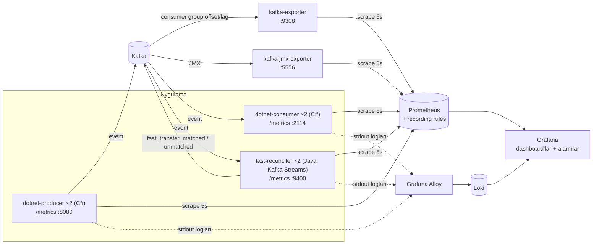

# Dashboard'lar ve alarmlar

Bu doküman FAST transfer akışının Grafana'da nasıl izlendiğini anlatır. Üç konuyu kapsar:

1. Verinin Grafana'ya nasıl geldiği.
2. Her dashboard'un ve panelin ne gösterdiği, neden konulduğu.
3. Alarmların ne zaman, neden çaldığı ve çaldığında nereye bakılacağı.

Grafana: http://localhost:3000 (admin/admin). Dashboard'lar `FAST` ve `Kafka` klasörlerindedir. Her dashboard'un sağ üstündeki **FAST lab** menüsü diğerlerine geçiş sağlar (zaman aralığı korunur).

- [1. Veri Grafana'ya nasıl geliyor](#1-veri-grafanaya-nasıl-geliyor)
- [2. Dashboard'lar](#2-dashboardlar)
  - [FAST Operations](#fast-operations)
  - [FAST Services](#fast-services)
  - [Kafka Consumer Groups & Broker](#kafka-consumer-groups--broker)
- [3. Alarmlar](#3-alarmlar)
- [4. Yeni metrik, panel veya alarm eklemek](#4-yeni-metrik-panel-veya-alarm-eklemek)
- [5. Bilinen kısıtlar](#5-bilinen-kısıtlar)

---

## 1. Veri Grafana'ya nasıl geliyor



Veri altı kaynaktan gelir. Hepsi Prometheus'a (5 saniyede bir scrape) veya Loki'ye gider; Grafana bu ikisini okur:

| Kaynak | Ne üretir | Nasıl toplanır | Kullanıldığı yer |
|---|---|---|---|
| **Producer** (`dotnet-producer`, 2 replica) | Yazılan event sayısı ve TRY tutarı, HTTP istek sayısı ve süresi, hatalar, .NET runtime | Uygulama `prometheus-net` ile `/metrics` sunar. Prometheus her replica'yı Docker DNS üzerinden ayrı bulur (`dns_sd_configs`). | FAST Services, FAST Operations (transfer sayısı) |
| **Consumer** (`dotnet-consumer`, 2 replica) | Teknik metrikler: tüketilen event sayısı, hatalar, Kafka → consumer gecikmesi, partition dağılımı, runtime | Producer ile aynı şekilde: `/metrics`, replica başına scrape | FAST Services |
| **Reconciler** (`fast-reconciler`, Kafka Streams, 2 instance) | FAST iş metrikleri: eşleşen transferler, tamamlanma süresi (banka bazında), banka/tutar/hata nedeni kırılımları, bekleyen/takılı/eşleşmeyen transferler; Kafka Streams ve JVM metrikleri | Micrometer ile `/metrics` (:9400); Prometheus instance'ları Docker DNS ile bulur. Eşleşen ve eşleşmeyen transferler ayrıca `fast_transfer_matched` / `fast_transfer_unmatched` topic'lerine tek tek yazılır. | FAST Operations, FAST Services → Reconciler |
| **kafka-exporter** | Consumer group başına committed offset, lag ve üye sayısı; topic'lerin son offset'leri; broker sayısı | Kafka'ya bağlanıp offset'leri okur, `:9308/metrics` sunar | Alarmlar, Kafka dashboard'u, FAST Operations hacim grafikleri |
| **kafka-jmx-exporter** | Broker iç metrikleri: mesaj/s, byte/s, controller ve partition sağlığı, istek süreleri | Kafka'nın JMX portuna (9999) bağlanır, `:5556/metrics` sunar | Kafka dashboard'u → Broker bölümü |
| **Loglar** | Producer, consumer ve nginx'in stdout logları | Grafana Alloy, Docker container'larını keşfeder ve logları `container` label'ıyla Loki'ye gönderir | FAST Services → Logs |

### Hangi bilgi nereden gelir

Aynı akış üç farklı kaynaktan ölçülür. Her birinin güçlü olduğu yer farklıdır:

- **Reconciler metrikleri** (`fast_reconciler_*`): FAST'in **iş** görünümü.
  - Her transfer `fast_send` ile sonucunun eşleşmesinden sonra **bir kez** sayılır. Banka ve tutar her zaman `fast_send`'den alınır.
  - Tamamlanma süresi, takılı ve eşleşmeyen transferler yalnızca burada vardır, çünkü iki event'i birleştirmek durum gerektirir.
  - Durum Kafka Streams state store'undadır. Restart, ölçekleme veya rebalance'ta kaybolmaz.
- **Uygulama sayaçları** (`producer_*`, `consumer_*`): servislerin **teknik** sağlığı.
  - API istekleri, hatalar, tüketim hızı, replica dağılımı ve gecikme.
  - Process yeniden başladığında **sıfırlanır**. Panellerde bu yüzden `rate()` / `increase()` ile kullanılır.
- **Kafka offset'leri** (`kafka_consumergroup_*`, `kafka_topic_partition_*`): consumer group bazında ve **kalıcı**.
  - Hacim alarmları bilinçli olarak buna dayanır, böylece reconciler çalışmasa da hacim alarmları çalışır.
  - Lag ve partition panelleri de buradan gelir.

**Çıktı topic'lerinin offset'leri sayım için kullanılmaz.** `fast_transfer_matched` / `fast_transfer_unmatched` exactly-once ile yazılır; offset'ler transaction işaretlerini de içerdiği için kayıt sayısından büyüktür. Sayılar reconciler metriklerinden, tek tek kayıtlar topic'lerden okunur.

### Prometheus recording rule'ları

Alarmlar ve bazı paneller, [observability/prometheus/rules/fast.yml](./observability/prometheus/rules/fast.yml) içindeki önceden hesaplanmış serileri kullanır. Kurallar 15 saniyede bir hesaplanır ve tümü `consumergroup` bazındadır:

| Seri | Anlamı |
|---|---|
| `fast:sent:increase5m` | Group'un son 5 dakikada tükettiği `fast_send` sayısı |
| `fast:outcome:increase5m` | Son 5 dakikada tüketilen `fast_send_success + fast_send_failed` |
| `fast:success:increase5m`, `fast:failed:increase5m` | Sonuçların ayrı ayrı sayısı |
| `fast:failed_success:ratio5m` | `failed / success`. 5 dakikada 20'den az sonuç varsa hesaplanmaz. |
| `fast:outcome_mismatch:ratio5m` | `\|send − outcome\| / send`. 5 dakikada 20'den az event varsa hesaplanmaz. |
| `fast:business_hours` | İstanbul saatiyle 09:00–18:00 arası `1`, diğer saatlerde `0` |

Bu seriler iki işe yarar:

- **Tek tanım:** alarm ve dashboard aynı tanımı kullanır, yani dashboard'da görülen çizgi alarmın baktığı değerin kendisidir.
- **Hız:** sorgular hafifler.

### Grafana'ya provisioning

Grafana elle yapılandırılmaz; her şey dosyadan yüklenir (`observability/grafana/provisioning/`):

| Dosya | Ne yükler |
|---|---|
| `datasources/prometheus.yml`, `datasources/loki.yml` | Prometheus ve Loki veri kaynakları. UID'ler sabittir, alarmlar bu UID'lere bağlıdır. |
| `dashboards/dashboards.yml` | `observability/grafana/dashboards/` altındaki JSON'lar. **Alt klasör adı Grafana klasörü olur** (`FAST/`, `Kafka/`). |
| `alerting/fast-alerts.yml` | FAST alarmları, `FAST` klasörüne yüklenir |

---

## 2. Dashboard'lar

| Klasör | Dashboard | Kimin için | Cevapladığı soru |
|---|---|---|---|
| FAST | [FAST Operations](#fast-operations) | İş / operasyon | Transferler sağlıklı mı? Ne kadar para geçti, hangi banka sorunlu? |
| FAST | [FAST Services](#fast-services) | Uygulama ekibi | Servisler ve replica'lar sağlıklı mı? Sorun API'de mi, consumer'da mı? |
| Kafka | [Kafka Consumer Groups & Broker](#kafka-consumer-groups--broker) | Platform | Kafka geride kalıyor mu? Hangi partition birikiyor, broker sağlıklı mı? |

Neden üç ayrı dashboard var:

- Her biri farklı bir kitleye farklı bir soruyu cevaplar.
- Tek dashboard'da toplandığında (önceki sürümde 90+ panel vardı) aynı bilgi birkaç yerde tekrar ediyor ve önemli sinyaller kayboluyordu.
- Bir sorun önce **FAST Operations**'ta görülür. Kök neden **FAST Services**'te (uygulama) veya **Kafka** dashboard'unda (altyapı) aranır.

### FAST Operations

`FAST / FAST Operations` (`/d/fast-operations`): iş gözüyle FAST akışı.

**Değişkenler:**

- `Consumer group`: hacim ve oran grafikleri için (varsayılan `fast-transfer-consumers-dotnet`).
- `Bank role`: `sender` veya `receiver`.
- `Bank`: banka filtresi.

**İşaret:** consumer group üyeliği değiştiğinde (restart/rebalance) grafiklerde mor işaret çıkar.

#### Overview

Sayfayı açan kişinin 5 saniyede durumu anlaması için var. Tutar ve sayılar seçili zaman aralığı içindir.

| Panel | Ne gösterir | Neden var |
|---|---|---|
| Transfers (fast_send) | Kafka'ya yazılan `fast_send` sayısı (topic offset'leri) | Trafiğin büyüklüğü |
| Success rate | Eşleşen transferlerde `success / (success + failed)` | En temel iş sağlığı göstergesi; %95 altı sarı, %80 altı kırmızı |
| Completion time p95 | `fast_send` → sonuç süresi | FAST "anlık" olmalı; bu değer fiilen SLA'dır |
| Stuck transfers (> 30s) | 30 sn'den uzun sonuç bekleyen transfer | Müşterinin "param nerede" dediği transferler |
| Successful volume | Başarılı transferlerin TRY toplamı | İşin parasal büyüklüğü |
| Failed amount (at risk) | Başarısız transferlerin TRY toplamı | Hata sayısından daha anlamlı bir risk göstergesi |

#### Alerts

Alarmların görünür olması için bu bölüm sayfanın en üstündedir.

| Panel | Ne gösterir | Neden var |
|---|---|---|
| Firing / Pending | Çalan ve beklemedeki FAST alarmı sayısı (kırmızı / turuncu) | Tek bakışta "bir şey var mı?" sorusunun cevabı |
| FAST alerts | 9 kuralın tamamı ve durumları; çalanlar en üstte | Hangi alarmın, hangi consumer group için çaldığı |
| Thresholds | Her alarmın eşiği | Eşikleri aramadan görmek için |

#### Volume vs alert thresholds

Alarmların baktığı değerlerin zaman içindeki hâli. Alarm eşikleri grafiklerde **kesikli çizgi** olarak çizilir; bir alarmın neden çaldığı (veya çalmadığı) burada görülür.

| Panel | Ne gösterir | Neden var |
|---|---|---|
| fast_send per 5m | Son 5 dakikada tüketilen `fast_send`; geçen haftanın aynı saati (gri kesikli); mesai saatleri (gölge) | Düşük / yüksek hacim alarmları. Geçen hafta çizgisi "bu saat için normal ne" sorusunu cevaplar; eşikleri ayarlamaya yarar. |
| Outcomes (success + failed) per 5m | Aynısı, sonuç event'leri için | Sonuç hacmi alarmları |
| fast_send_failed per 5m | 5 dakikalık başarısız sayısı; çizgi 500'de | `FAST failed count high` |
| failed / success ratio | Başarısız / başarılı oranı; çizgi %20'de | `FAST failed/success ratio high` |
| send / outcome mismatch | Sonucu gelmeyen (veya send'i olmayan) transfer oranı; çizgi %10'da | `FAST send/outcome mismatch` |

#### Transfer completion

Reconciler, her `fast_send`'i aynı `transaction_id`'li sonucuyla eşleştirir. Bu bölüm o eşleştirmenin sonucudur.

| Panel | Ne gösterir | Neden var |
|---|---|---|
| Completion time p50 / p95 / p99 | Tamamlanma süresi yüzdelikleri | Yavaşlamayı erken görmek; p99 kuyruktaki uç durumları gösterir |
| Completion time distribution | Sürelerin heatmap'i | Ortalamanın gizlediği iki tepeli dağılımları görmek |
| Slowest banks: completion p95 (top 5) | Gönderen banka başına tamamlanma süresi | "Hangi banka yavaş?" sorusunun cevabı. Bu panel yalnızca eşleştirmeyle mümkündür. |
| Waiting and unmatched transfers | Sonuç bekleyen, 30 sn'den uzun bekleyen (takılı), send'i olmayan sonuçlar ve 10 dakikada eşleşmeyenler (türüne göre) | "Kayıp" transferleri **tek tek** sayar. Mismatch alarmı toplam sayıları karşılaştırırken bu panel eşleşmeye bakar. Eşleşmeyenlerin `transaction_id`'leri `fast_transfer_unmatched` topic'indedir. |

#### Banks ($role)

| Panel | Ne gösterir | Neden var |
|---|---|---|
| Bank summary | Banka başına tamamlanan transfer, başarılı, başarısız, hata oranı, başarılı TRY hacmi | "Sorun hangi bankada?" sorusunun cevabı. Hata oranı hücresi %10 üstünde sarı, %20 üstünde kırmızıdır. Banka ve tutar `fast_send`'den alındığı için sonuç event'leri bu bilgiyi taşımasa da doğrudur. |
| Successful volume share (TRY) | Bankaların hacim payı | Bir bankadaki sorunun ne kadar parayı etkilediği |
| Failure rate by bank (top 5) | En kötü 5 bankanın hata oranı | Sorunun ne zaman başladığını ve hangi bankada olduğunu görmek |
| Completed transfers / s by bank | Banka başına tamamlanan transfer hızı | Bir bankanın trafiğinin aniden düşmesi, o tarafta bir kesinti işareti olabilir |

`Bank role` = `sender` gönderen bankaya, `receiver` alıcı bankaya göre kırar. Enpara.com, QNB'nin kodunu (00111) kullandığı için `QNB / Enpara.com` olarak birlikte görünür. Listede olmayan kodlar `other` altında toplanır.

#### Money and failures

| Panel | Ne gösterir | Neden var |
|---|---|---|
| TRY volume per minute | Dakikalık TRY hacmi (başarılı / başarısız) | Parasal akışın zaman içindeki hâli |
| Average transfer amount | Ortalama tutar | Olağan dışı tutar desenlerini (ör. ani büyük transferler) fark etmek |
| Amount distribution | Tutar aralıklarına göre transfer sayısı | Trafiğin hangi tutar bandında yoğunlaştığı |
| Failed transfers by reason | Hata nedenleri (`INSUFFICIENT_BALANCE`, `RECEIVER_BANK_TIMEOUT`…) | Hatanın müşteri kaynaklı mı, sistem kaynaklı mı olduğunu ayırmak |

### FAST Services

`FAST / FAST Services` (`/d/fast-services`): servislerin ve replica'ların teknik sağlığı.

**Değişkenler:**

- `Consumer group`
- `Service`: log paneli için.
- `Log filter`: regex.

#### Replicas

| Panel | Ne gösterir | Neden var |
|---|---|---|
| Producer / Consumer replicas up | Ayakta olan replica sayısı (2 = yeşil) | Ölçeklenmiş sistemde bir replica'nın düşmesi trafikte hemen görünmez; burada görünür |
| Consumer group members | Kafka'nın gördüğü üye sayısı | Ayakta olan consumer replica sayısına eşit olmalı; farklıysa replica çalışıyor ama group'a katılamamıştır |
| API error rate / API p95 | 5 dakikalık 2xx dışı oran ve yanıt süresi | API sağlığının özeti |
| Consumer errors (5m) | Okuma veya decode hataları | Consumer sağlığının özeti |

#### Producer API

| Panel | Ne gösterir | Neden var |
|---|---|---|
| Requests / s by endpoint and status | Endpoint ve HTTP kodu bazında istek hızı (4xx turuncu, 5xx kırmızı) | Hangi event'te sorun olduğu |
| Response time p95 / p99 | Endpoint bazında yanıt süresi (Kafka'ya yazma dahil) | Kafka yavaşladığında ilk burada görülür |
| Requests / s per replica | Replica başına istek | nginx yükünü dengeli dağıtıyor mu? |
| Error rate: 4xx vs 5xx | Doğrulama hataları ile Kafka yazma hatalarını ayırır | 4xx istemci sorunudur, 5xx bizim sorunumuzdur |
| Producer errors by reason | `invalid_json` / `validation` / `kafka` | Hatanın kök nedeni |

#### Consumer replicas

| Panel | Ne gösterir | Neden var |
|---|---|---|
| Events consumed / s per replica | Replica başına tüketim | İş yükü dağılımı. 3 partition 2 replica'ya dağıldığı için oran yaklaşık 2:1'dir. |
| Partitions per replica | Hangi replica'nın hangi partition'ı okuduğu | Rebalance sonrası dağılımın değiştiğini görmek |
| Kafka → consumer latency p95 | Mesajın Kafka'ya yazılmasından tüketilmesine kadar geçen süre | Backlog varken yükselir; hangi replica'nın geride kaldığını gösterir |
| Consumer errors / s | Replica ve neden bazında hatalar | Sorunun yerini bulmak |

#### Reconciler (Kafka Streams)

Eşleştirmeyi yapan servisin sağlığı. Bu servis çalışmazsa FAST Operations'taki tamamlanma, banka ve tutar panelleri güncellenmez. Hacim alarmları ise Kafka offset'lerine dayandığı için çalışmaya devam eder.

| Panel | Ne gösterir | Neden var |
|---|---|---|
| Instances RUNNING | Kafka Streams durumu `RUNNING` olan instance sayısı | `FAST reconciler down` alarmının baktığı değer |
| Input lag | Reconciler'ın henüz okumadığı FAST event'leri | Reconciler geride kalırsa iş metrikleri gecikir |
| Restore remaining | Rebalance sonrası changelog'dan geri yüklenecek kayıt | Ölçekleme veya restart sonrası state'in taşınmasını izlemek; 0'a inmeli |
| Failed stream threads | Çöken Kafka Streams thread'leri | Thread'ler otomatik yenilenir; artış bir hatanın tekrarladığını gösterir |
| In-flight transfers / Stuck | State store'da diğer yarısını bekleyen kayıtlar | Eşleştirme yükü |
| Records processed / s per instance | Instance başına işlenen kayıt | Yükün instance'lara dağılımı |
| Reconciler lag by topic | Girdi topic'leri ve iç repartition topic'i için lag | Hangi aşamanın geride kaldığı |
| Commit / scan latency | Exactly-once transaction commit süresi ve periyodik state taramasının süresi | Yavaşlama kaynağını bulmak; tarama süresi state büyüdükçe artar |
| In-flight transfers per instance | Instance başına bekleyen kayıtlar | Ölçekleme sırasında state'in instance'lar arasında taşındığını görmek |
| JVM heap per instance | Java heap kullanımı | Bellek sızıntısı veya kapasite |

#### Runtime (per replica)

| Panel | Ne gösterir | Neden var |
|---|---|---|
| Managed heap / Working set | .NET GC heap ve process belleği | Bellek sızıntısı (sürekli artan çizgi) |
| CPU | Replica başına CPU (1.0 = bir çekirdek) | Ölçekleme ihtiyacı |
| GC collections / s | GC sıklığı | Yük altında GC baskısı |

#### Logs

| Panel | Ne gösterir | Neden var |
|---|---|---|
| Error / warning log lines per minute | Producer, consumer ve reconciler container'ları için hata/uyarı log sayısı (Loki) | Metriklerin yakalamadığı hataları görmek |
| Error / warning logs | Hata ve uyarı satırları | Bir grafikteki sıçramanın ayrıntısına inmek |
| All service logs | `Service` ve `Log filter` ile filtrelenen tüm loglar | Belirli bir transferi izlemek, ör. filtreye bir `transaction_id` yazarak |

### Kafka Consumer Groups & Broker

`Kafka / Kafka Consumer Groups & Broker` (`/d/kafka-consumer-groups`): Kafka tarafının teknik sağlığı.

**Değişkenler:**

- `Consumer group`: çoklu seçim yapılabilir.
- `Topic`: yalnızca `fast_send*` topic'leri listelenir.

#### Consumer group

| Panel | Ne gösterir | Neden var |
|---|---|---|
| Group members | Group'taki consumer sayısı | 0 ise kimse tüketmiyordur |
| Total lag | Yazılıp henüz tüketilmemiş mesaj sayısı | Consumer'ın geride kalıp kalmadığının ana göstergesi |
| Consume rate / Produce rate | Tüketme ve üretme hızı | Tüketme, üretmeden sürekli düşükse lag büyür |
| Estimated drain time | `lag / tüketme hızı` | Birikmiş işin ne zaman biteceği |
| Topic partitions | Toplam partition sayısı | Consumer ölçeklemesinin üst sınırı: partition sayısından fazla replica boşta kalır |
| Produce vs consume rate | İki hızın zaman içindeki hâli | Lag'in neden büyüdüğünü görmek |
| Lag by topic | Topic başına lag | `fast-send-backlog` testinde yalnızca `fast_send` lag'i büyür |

#### Partitions

| Panel | Ne gösterir | Neden var |
|---|---|---|
| Lag per partition | Topic ve partition başına lag | Lag tek bir partition'daysa sorun o partition'ın sahibi olan replica'dadır |
| Consume rate per partition | Partition başına tüketim hızı | Durmuş bir partition'ı bulmak |
| Group members over time | Üye sayısının değişimi | Restart ve rebalance anlarını görmek |
| Partition status | End offset, committed offset ve lag tablosu | Tam sayılarla doğrulama |
| Lag by topic / partition | Lag'in çubuk grafiği | En çok biriken partition'ı tek bakışta görmek |

#### Broker

| Panel | Ne gösterir | Neden var |
|---|---|---|
| Brokers / Active controller | Ayakta olan broker ve controller | Kafka ayakta mı? |
| Offline / Under-replicated partitions | Erişilemeyen veya kopyası eksik partition | 0 olmalı; değilse veri riski vardır |
| Messages in / s by topic | Broker'a gelen mesaj hızı | Producer metriklerini Kafka tarafından doğrulamak |
| Bytes in / out | Broker trafiği | Ağ ve disk kapasitesi |
| Request time p99 | Produce ve FetchConsumer isteklerinin broker tarafındaki süresi | API yavaşsa sorunun Kafka'da olup olmadığını ayırmak. FetchConsumer, boşta beklerken ~500 ms gösterir; bu normaldir. |

---

## 3. Alarmlar

Alarmlar Grafana Alerting ile tanımlıdır ([fast-alerts.yml](./observability/grafana/provisioning/alerting/fast-alerts.yml)) ve `FAST` klasöründedir.

- **İlk yedi alarm:** `fast-transfer-consumers-dotnet` consumer group'unun Kafka offset'lerine bakar.
- **Son iki alarm:** reconciler'ın kendi metriklerine bakar.

**Nasıl değerlendirilir:**

- **Değerlendirme sıklığı:** 30 saniyede bir.
- **Sayılan değer (ilk yedi alarm):** group'un **son 5 dakikada** tükettiği event'ler. Kaynak Kafka offset'leridir (yukarıdaki recording rule'lar).
- **Bekleme süresi:** koşul ilk sağlandığında alarm **pending** olur. Koşul **5 dakika boyunca** sürerse **firing** olur. Kısa sıçramalar alarm üretmez.
- **Veri yokken** (düşük trafik veya mesai dışı): alarm **Normal** kalır.

| Alarm | Koşul | Ne zaman | Severity | Neden var | Çaldığında nereye bakılır |
|---|---|---|---|---|---|
| **FAST send volume low (business hours)** | `fast_send` < 100 / 5 dk | 09:00–18:00 İstanbul | warning | Mesai saatinde trafiğin düşmesi; genelde istemci, ağ veya producer tarafında bir kesinti | FAST Services → Producer API ve Replicas; producer logları |
| **FAST send volume high** | `fast_send` > 6000 / 5 dk | Her zaman | critical | Beklenmeyen yük: kampanya, tekrar eden istekler veya kötüye kullanım | FAST Services → Requests by endpoint; Kafka → lag |
| **FAST outcome volume low (business hours)** | `success + failed` < 100 / 5 dk | 09:00–18:00 İstanbul | warning | Transferler gidiyor ama sonuçlar gelmiyor | FAST Operations → Waiting transfers; Kafka → Lag by topic |
| **FAST outcome volume high** | `success + failed` > 6000 / 5 dk | Her zaman | critical | Sonuç akışında olağan dışı yük (ör. bir backlog'un bir anda boşalması) | Kafka → Produce vs consume rate |
| **FAST failed count high** | `fast_send_failed` > 500 / 5 dk | Her zaman | critical | Mutlak hata sayısı yüksek | FAST Operations → Failed by reason ve Bank summary |
| **FAST failed/success ratio high** | `failed / success` > %20 | Her zaman | critical | Trafik düşükken de anlamlı olan oransal bozulma | FAST Operations → Failure rate by bank (top 5) |
| **FAST send/outcome mismatch** | `\|send − outcome\| / send` > %10 | Her zaman | warning | Sonucu gelmeyen transferler veya send'i olmayan sonuçlar (veri kaybı, eksik entegrasyon) | FAST Operations → Waiting and unmatched transfers; Kafka → Lag by topic |
| **FAST stuck transfers high** | 30 sn'den uzun sonuç bekleyen transfer > 50 | Her zaman | warning | Müşterinin parası çıkmış ama sonuç gelmemiş; karşı banka veya sonuç akışında bir sorun | FAST Operations → Slowest banks ve Waiting and unmatched; `fast_transfer_unmatched` topic'i |
| **FAST reconciler down** | `RUNNING` reconciler instance'ı yok (2 dk) | Her zaman | critical | İş metrikleri (tamamlanma, banka, tutar, takılı) güncellenmiyor | FAST Services → Reconciler; `docker compose logs fast-reconciler` |

**Notlar:**

- **Mesai saati koşulu:** düşük hacim alarmları yalnızca mesai saatlerinde değerlendirilir. Gece trafiğin düşük olması normaldir ve alarm üretmemelidir.
- **Oranlar için en az 20 event:** 5 dakikada 20'nin altında event varsa oranlar hesaplanmaz. Aksi hâlde düşük trafikte tek bir sonuçsuz transfer "%100 mismatch" yapardı.
- **Consumer tamamen durursa:** mesai saatlerinde **düşük hacim** alarmları çalar, çünkü group hiçbir şey tüketmez. Mesai dışında bu durum Kafka dashboard'undaki lag ile görülür.
- **Backlog boşalırken:** bir `fast_send` backlog'u bir anda tüketildiğinde, kısa süreliğine `mismatch` alarmı **pending** olabilir. Backlog 5 dakikadan kısa sürede eriyorsa firing olmaz.
- **Reconciler alarmının veri yokken davranışı:** `FAST reconciler down` için "veri yok" durumu da alarm sayılır (`noDataState: Alerting`). Hiçbir instance scrape edilemiyorsa da çalar.
- **Bildirim yok:** henüz bir contact point tanımlı değil. Alarmlar yalnızca Grafana'da (Alerting menüsü ve FAST Operations → Alerts) görünür. Slack veya e-posta için Grafana'da bir contact point ve notification policy eklenmelidir.

**Alarmları test etmek** için Artillery case'leri vardır ([performance/artillery/README.md](./performance/artillery/README.md)). Alarm testleri aynı anda çalıştırılmamalıdır, çünkü trafikleri birbirine karışır.

| Case | Tetiklediği alarm |
|---|---|
| `missing-outcomes` | send/outcome mismatch |
| `high-failure` | failed count high, failed/success ratio high |
| `fast-send-spike` | send volume high, outcome volume high |
| `low-volume` (yalnızca mesai saatinde) | send volume low, outcome volume low |
| `fast-send-backlog` (consumer kapalı, sonuç yok) | 30 sn sonra takılı transferler artar; 50'yi geçip 5 dk sürerse stuck transfers high |
| `docker compose stop fast-reconciler` (elle) | 2 dk sonra reconciler down |

**Eşik veya süre değiştirmek:**

1. `fast-alerts.yml` içinde ilgili kuralın `params` (eşik) ve `for` (süre) değerini değiştirin.
2. Dosyanın başındaki tabloyu güncelleyin.
3. `docker compose restart grafana` çalıştırın.

Mesai saatleri ise `rules/fast.yml` içindeki `fast:business_hours` kuralındadır (`9` / `18`, UTC+3 sabit). Değiştirdikten sonra `docker compose kill -s HUP prometheus` çalıştırın.

---

## 4. Yeni metrik, panel veya alarm eklemek

Bir bilginin dashboard'da görünmesi için zincirin her halkası tamamlanmalıdır. Kaynaktan Grafana'ya doğru:

### a) Uygulamada metrik üretmek

Önce metriğin nereye ait olduğuna karar verin:

- **Tek bir event'ten çıkan teknik bir ölçüm** (istek süresi, hata, tüketim hızı): producer veya consumer'a, `prometheus-net` ile.
- **Transfer bazında bir iş ölçümü** (iki event'in birleşimi, banka/tutar kırılımı, süre): reconciler'a, Micrometer ile ([ReconcilerMetrics.java](./reconciler/src/main/java/fast/reconciler/ReconcilerMetrics.java)):

  ```java
  Counter.builder("fast.reconciler.refunds")          // Prometheus: fast_reconciler_refunds_total
          .tags("reason", reason).register(registry).increment();
  ```

C# servislerinde ör. [ConsumerApp.cs](./dotnet/FastTransfer.Consumer/ConsumerApp.cs):

```csharp
static readonly Counter Refunds = Metrics.CreateCounter(
    "consumer_fast_refunds_total", "Refunded FAST transfers, by reason.", "reason");
...
Refunds.WithLabels(reason).Inc();
```

Kurallar:

- **Ad:** `<servis>_<ne>_<birim>` biçiminde olmalı. Sayaçlar `_total` ile biter.
- **Sınırlı label:** label değerleri sınırlı bir küme olmalıdır (event, banka, neden). `transaction_id`, IBAN veya tutar **label yapılmaz**; her biri yeni bir seri üretir ve Prometheus'u şişirir. Tanımsız değerler `other` gibi tek bir değerde toplanmalıdır (bkz. `Banks.labels`). Transfer bazında ayrıntı gerekiyorsa çıktı topic'ine yazılır, metriğe değil.
- **Görünürlük:** metrik `/metrics` endpoint'inde otomatik görünür. Kontrol: `curl localhost:2114/metrics | grep consumer_fast_refunds`.

### b) Prometheus'un toplaması

- Mevcut servislere eklenen metrikler için bir şey yapmak gerekmez; replica'lar zaten scrape ediliyor.
- **Yeni bir servis** için [prometheus.yml](./observability/prometheus.yml)'e bir `job` ekleyin. Replica'lı servislerde `dns_sd_configs` kullanın ve `impl` label'ını ekleyin. Ardından `docker compose kill -s HUP prometheus` çalıştırın.
- Kontrol: http://localhost:9090/targets sayfasında hedef `UP` olmalı.

### c) (İsteğe bağlı) Recording rule

Alarm ve dashboard aynı hesaplamayı kullanacaksa veya sorgu ağırsa [rules/fast.yml](./observability/prometheus/rules/fast.yml)'e bir kural ekleyin. Ad `seviye:metrik:işlem` biçiminde olmalı (ör. `fast:refunds:increase5m`). Ardından:

```bash
docker compose kill -s HUP prometheus
```

### d) Panel eklemek

1. Paneli Grafana'da tasarlayın.
2. Dashboard'u **Export → Export as JSON** ile dışa alın.
3. JSON'u `observability/grafana/dashboards/<Klasör>/` altındaki dosyaya yazın. Klasör adı Grafana klasörü olur.
4. Sorgularda veri kaynağı olarak `${datasource}` (Prometheus) veya `${loki}` değişkenini kullanın. Uygulama metriklerine `impl="dotnet"` filtresini ekleyin.
5. `docker compose restart grafana` çalıştırın. Windows bind mount'larında dosya değişikliği her zaman algılanmadığı için restart en güvenli yoldur.

Provisioned dashboard'lar Grafana UI'dan doğrudan kaydedilemez. Kaynak her zaman repo'daki JSON dosyasıdır; değişiklik kalıcı olsun diye dosyaya yazılır.

### e) Alarm eklemek

1. [fast-alerts.yml](./observability/grafana/provisioning/alerting/fast-alerts.yml)'e mevcut bir kuralı kopyalayarak yeni bir kural ekleyin:
   - **`uid`:** benzersiz olmalı.
   - **Sorgu (`refId: A`):** `instant: true` olmalı.
   - **`datasourceUid`:** `PBFA97CFB590B2093` (Prometheus).
   - **Eşik (`refId: C`):** `type: threshold`, `gt` veya `lt`.
2. `for` ve `noDataState` alanlarını belirleyin, `severity` label'ını ekleyin.
3. Dosya başındaki tabloya ve bu dokümana satır ekleyin.
4. `docker compose restart grafana` çalıştırın. Kontrol: Grafana → Alerting → Alert rules altında kuralın `health` değeri `ok` olmalı.

### f) Log göstermek

Uygulamanın stdout'a yazması yeterlidir. Alloy tüm container'ları otomatik keşfeder ve `container` label'ıyla Loki'ye gönderir. Sorgu örneği:

```logql
{container=~".*dotnet-consumer.*"} |= "transaction_id=tx-1001"
```

---

## 5. Bilinen kısıtlar

- **Uygulama sayaçları restart'ta sıfırlanır.** Bu sayaçlar `rate()` / `increase()` ile kullanıldığı için grafikler etkilenmez. Restart anında stat panelleri kısa süre düşük gösterebilir. Kalıcı toplamlar için Kafka offset'leri kullanılır.
- **Reconciler sayaçları "yan etki"dir.** Çıktı topic'leri exactly-once ile tam doğrudur. Ancak bir transaction yeniden denendiğinde Prometheus sayacı iki kez artabilir; bu nadirdir. Kesin sayı gerektiğinde topic'ler esas alınır.
- **State taraması tüm state'i gezer.** Takılı/eşleşmeyen tespiti için her 5 saniyede bekleyen kayıtların tamamı taranır. Bekleyen kayıt sayısı (normalde yüzler) çok büyürse `Commit / scan latency` panelinden izlenmeli; gerekirse zamana göre indekslenmiş bir store'a geçilmeli.
- **Reconciler ilk açılışta geçmişi işler.** Yeni bir `APPLICATION_ID` ile başlatıldığında topic'leri baştan okur. Eşleşmesi çok önce bitmiş eski kayıtlar ilk taramada "unmatched" olarak raporlanabilir.
- **"Last week" çizgileri** en az bir haftalık veri birikene kadar boştur. Prometheus verisi varsayılan olarak 15 gün tutulur.
- **Eski Go consumer group'u** (`fast-transfer-consumers`) Kafka'da duruyorsa Kafka dashboard'unda görünebilir. Alarmlar ve FAST dashboard'ları onu dikkate almaz. Silmek için README'deki komut kullanılabilir.
